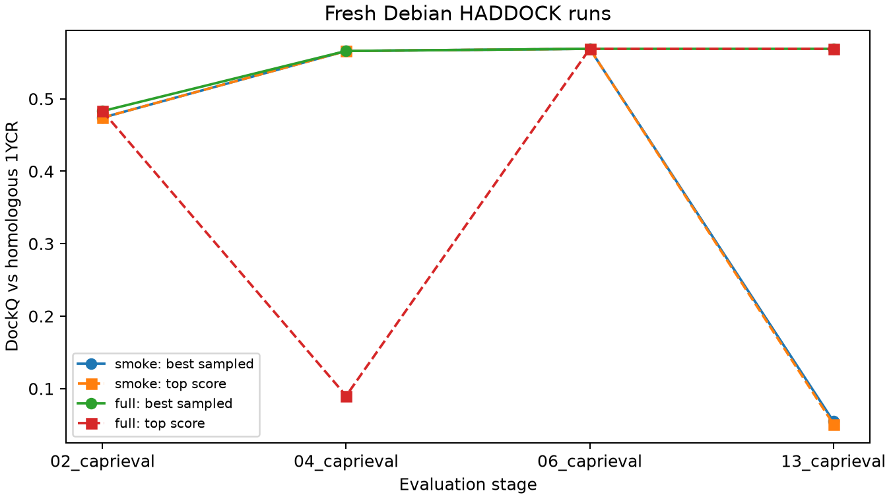

# 多肽结构与 HADDOCK3

> 本文对应网站教案的 Debian 版本。仓库练习请先读同目录 [README](README.md)：其中命令使用本仓库目录和可配置工具路径；正文的运行命令已按仓库路径调整；多工具任务统一通过可配置入口执行。

假设你手里有一条能够与 MDM2 结合的 p53 来源肽，现在想改变它的序列。动手之前，首先要知道它怎样贴在 MDM2 表面：哪些侧链伸进了口袋，哪些位置朝向溶剂，哪些地方改变后可能影响结合。我们从这个问题开始学习分子对接。

对接要寻找的是两个分子的相对位置和形状。你可以把它想成反复尝试摆放一条柔软的链，这条链的运动受到原子尺寸、电荷和化学键的约束。软件需要在许多可能姿态中搜索，再按照一套近似规则给候选排序。本章从软件安装和输入准备开始，带你建立一项自己的对接任务，再用真实结果解释采样与评分。学完后，你应能说清每份输入怎样制作、每个阶段在做什么，以及怎样判断一份输出是否值得继续研究。

## 1. 从官方的小鼠体系开始

本章跟随 [HADDOCK3 官方教程](https://www.bonvinlab.org/education/HADDOCK3/HADDOCK3-protein-peptide/)，对接对象是**小鼠 MDM2 与小鼠 p53 来源肽**。受体输入为预测得到的 MDM2 第 26–109 位片段；肽输入是小鼠 p53 第 18–32 位，共 15 个残基：

```text
SQETFSGLWKLLPPE
```

序列中的每个字母代表一个氨基酸残基。先从左往右数：F 在第 5 位，W 在第 9 位，关键的 L 在第 12 位。F 是苯丙氨酸，W 是色氨酸，L 是亮氨酸；它们的疏水侧链是本案例中理解结合界面的重要线索。

这里又出现了两种编号。这段肽从完整小鼠 p53 的第 18 位开始，因此肽内第 5 位 F 对应完整序列 F22，第 9 位 W 对应 W26，第 12 位 L 对应 L29。程序使用哪种编号，要看它实际读取的结构与接口。后面分析官方鼠源模型的接触时，我们关注的肽内位置就是 **5/9/12**。

对接的两份输入可以在官方配置中直接找到：

```toml
molecules = [
    "pdbs/AF_MDM2_26_109.pdb",
    "pdbs/peptide_ens.pdb"
]
```

第一份提供小鼠受体坐标，第二份提供小鼠肽的起始构象集合。

### 人源 1YCR 为什么也会出现

搜索产生姿态以后，需要一个参考来检查它摆得是否接近已知结合方式。官网给出的理由是：在这个教学设定中没有可用的小鼠 MDM2–p53 实验复合物结构，因此借用人源同源复合物作评价参考；它还利用人源 MDM2 的已知界面信息辅助定义鼠源对接约束。官方教程在评价模块中指定了 `reference_fname = "pdbs/1YCR.pdb"`，也就是由人源实验复合物 1YCR 准备的参考。**小鼠结构用于对接，人源结构用于参考比较**，这是两个不同角色。

人源原始 1YCR 中，p53 肽有坐标的片段为 `ETFSDLWKLLPEN`，共 13 个残基。它的 F19/W23/L26 对应片段内的 3/7/10，与鼠源输入的 5/9/12 不同。比较结构时，需要先建立两套序列之间的残基对应关系，再据此对齐和评价。

因此，本章的 DockQ 应理解为在官方参考与残基映射下，与人源实验结合姿态的接近程度。后面读分数时，需要同时考虑这个参考结构及其残基映射。

下一课的 ProteinMPNN 则会**另用人源 1YCR 的实验骨架**做序列设计练习。使用已知实验骨架，便于把逆折叠的输入条件固定下来，专门研究序列设计。这里先把小鼠对接案例读完整，到下一课开始时再切换输入。

## 2. 软件怎样尝试摆放一条柔软的肽

如果两个分子完全刚性，软件主要尝试平移和旋转。肽的困难在于：它自己还能弯曲。同一条序列既可能伸展，也可能呈螺旋状，不同侧链还能转向不同方向。因此，搜索空间不仅包括“放在哪里”，还包括“以什么形状放进去”。

为了探索不同的结合姿态，官方案例给同一条肽准备了三种起始构象：α 螺旋、β 链式伸展构象和多脯氨酸 II 型构象。它们的主链形状不同，放到受体附近时，会呈现出不同的接触方式。软件从这些构象分别开始搜索，再通过柔性精修调整肽与受体界面，从而有机会找到单一起始构象容易遗漏的结合姿态。

HADDOCK 的特点之一是可以把已有的相互作用信息用作约束。比如，实验或同源结构提示受体的某片表面参与结合，就让软件更关注这一带。这类约束允许一组候选原子接触共同满足距离条件，给搜索保留多种可能的配对方式；这类信息在教程中叫 AIR，即模糊相互作用约束。

于是，整个流程可以连贯地理解为：先准备分子和约束，粗略搜索大量相对姿态，再允许界面附近作柔性调整，消除明显不合理的接触，最后按评分和结构相似性整理候选。把相似的姿态分在一起叫“聚类”；这样可以避免结果列表被同一种解的许多近似副本占满。

这一过程中，约束提供的是搜索先验。若约束来自已知实验复合物，我们是在练习利用已有信息恢复合理姿态。这类任务属于有先验信息的建模，评价时要说明约束来源。

## 3. 使用 Debian 上的 HADDOCK3 环境

本轮使用 **HADDOCK3 2026.10.1、Python 3.11**。对接主要由 CPU 完成，完整任务使用 32 核。直接复用已安装环境：

```bash
cd .
# 先激活安装 HADDOCK3 的环境，或把它加入 PATH
command -v haddock3
haddock3 -h
haddock3-restraints -h
```

Python 分析使用 `python`。完整环境和源码清单见[Debian 版本表](../../docs/REPRODUCIBILITY.md)。现有环境缺少依赖时，先确认再创建环境或改动依赖。

下面的分步命令用于理解输入准备；已完成的本轮配置位于 `workflows/haddock_debian13_20261023/`。查看器中的 `pymol` 代码只用于观察结构，计算验收采用已保存的结构与数值表。

## 4. 先把输入准备成一套可以运行的文件

一次对接至少要交给软件两份**三维坐标**，以及说明工作流程的配置。这个案例还提供界面约束和评价参考。

| 文件                                     | 具体内容                       | 在任务中的作用              |
| -------------------------------------- | -------------------------- | -------------------- |
| `pdbs/AF_MDM2_26_109.pdb`              | 小鼠 MDM2，A 链，26–109，84 aa   | 受体坐标，定义蛋白表面和口袋       |
| `pdbs/peptide_ens.pdb`                 | 小鼠 p53 肽，B 链，1–15，三个 MODEL | 三种肽主链起点，供搜索使用        |
| `restraints/protein-peptide_ambig.tbl` | 受体候选界面与肽之间的 AIR            | 引导搜索区域，并为违反约束的姿态增加惩罚 |
| `pdbs/1YCR.pdb`                        | 经过整理的人源实验复合物               | 进入评价模块，计算与参考姿态的差异    |
| `workflows/full.cfg`                   | 文件路径、CPU 数和模块参数            | 决定先做什么、后做什么、保留多少模型   |

FASTA 中的字母串描述序列，PDB 中的 ATOM 行进一步给出每个原子的空间位置。HADDOCK3 从坐标开始对接，因此需要先把肽序列建成三维结构。`.tbl` 则用残基和原子选择表达已知的相互作用信息。

第一次实战先用官方已经整理好的输入，建立自己的工作目录。教材提供了一个[准备脚本](../../scripts/prepare_haddock_practice.py)：它复制输入、核对序列与编号，并生成小规模与正式两份配置。

```bash
cd '.'
source .venv-analysis/bin/activate
# 先激活安装 HADDOCK3 的环境，或把它加入 PATH
command -v haddock3
python scripts/prepare_haddock_practice.py --output workflows/my_haddock_practice
cd workflows/my_haddock_practice
mkdir -p scratch
```

运行后得到：

```text
my_haddock_practice/
  pdbs/                         Receptor, peptide ensemble, reference
  restraints/                   Active/passive lists and AIR file
  workflows/smoke.cfg            12-model practice workflow
  workflows/full.cfg            1000-model workflow
  preparation.json              Sequences, numbering and input hashes
```

`my_haddock_practice` 用于自己的练习，教材中的 `haddock3_practice` 保存本次实测记录。重新开始时使用新的目录名。准备脚本会在创建目录前检查：受体为 A26–109；肽的三个 MODEL 都是 B1–15，序列均为 `SQETFSGLWKLLPPE`；受体的 11 个 active 和肽的 15 个 passive 位置符合案例定义。

接下来的三节解释这些输入怎样制作。可以在这份工作副本中另建 `scratch/` 重建文件，对照官方输入观察差别。

## 5. 受体怎么准备：下载模型、截取结构域、核对编号

官方从小鼠 MDM2 的 UniProt 条目 **P23804** 找到 AlphaFold 模型，只保留 p53 结合结构域 26–109。全长蛋白还包含其他区域；截取当前任务所需结构域，可以集中搜索并减少计算量。

在 [AlphaFold 的 P23804 页面](https://alphafold.ebi.ac.uk/entry/P23804)下载 PDB 格式模型，放到练习目录的 `scratch/`。官方教程使用的原文件名为 `AF-P23804-F1-model_v4.pdb`。数据库更新后文件版本可能变化：记录下载版本，并在命令中填写实际文件名；对照本章已有结果时，使用上一节复制的官方输入快照。

在练习目录的终端中执行下列整理流程。这里以官方 v4 文件名为例：

```bash
mkdir -p scratch
pdb_keepcoord scratch/AF-P23804-F1-model_v4.pdb \
  | pdb_selres -26:109 \
  | pdb_chain -A \
  | pdb_tidy -strict > scratch/MDM2_prepared.pdb
```

这个管道按顺序传递处理结果：`pdb_keepcoord` 保留坐标记录，`pdb_selres` 选取 26–109，`pdb_chain` 将链标记为 A，`pdb_tidy` 整理 PDB 排版。最后的 `>` 把结果写入新文件。

**这里保留原始残基编号 26–109。** 约束中的 A54、A62 等位置使用同一套编号。如果改成从 1 开始，约束也必须按对应关系一起修改。格式整理完成后，在 PyMOL 打开 `scratch/MDM2_prepared.pdb`，检查主链是否连续、结合区域是否完整，并与官方受体叠合。

AlphaFold PDB 的 B-factor 列通常存放 pLDDT，可用于检查局部预测置信度。建模时还需要结合结构域边界、缺失坐标和界面几何判断输入质量。对于实验结构，则要逐项处理替代构象、水、金属、辅因子和缺失残基；保留哪些组分取决于它们在结合中的作用。

## 6. 肽怎么准备：从序列生成三个三维起点

本例输入序列为 `SQETFSGLWKLLPPE`。先让 PyMOL 的工作目录指向这次练习目录，再生成构象；以下都在 PyMOL 命令栏执行：

```pymol
cd ./workflows/my_haddock_practice
fab SQETFSGLWKLLPPE, peptide_helix, ss=1
fab SQETFSGLWKLLPPE, peptide_sheet, ss=2
fab SQETFSGLWKLLPPE, peptide_ppii, ss=0
save peptide_helix.pdb, peptide_helix
save peptide_sheet.pdb, peptide_sheet
save peptide_ppii.pdb, peptide_ppii
```

`fab` 按字母序列构建肽，第二个参数是对象名，`ss` 选择理想主链构象。三条命令分别生成 α 螺旋、β 链式伸展和 PPII 起点。保存后，把这三个 PDB 放入练习目录的 `scratch/`。

回到终端，把三份结构合成一个 ensemble 文件：

```bash
pdb_mkensemble  \
scratch/peptide_helix.pdb scratch/peptide_sheet.pdb scratch/peptide_ppii.pdb \
  | pdb_chain -B \
  | pdb_tidy -strict > scratch/peptide_ens.pdb
```

`pdb_mkensemble` 给各构象加上 `MODEL` / `ENDMDL` 分隔，`pdb_chain -B` 统一链名。输出应包含三个 MODEL，每个都有相同的 15 个残基，编号 1–15。三种起点提供不同的主链形状，后续柔性精修再调整界面。

运行前核对序列、链名和三个构象的原子组成是否一致。肽内 F5/W9/L12 分别对应完整小鼠 p53 的 F22/W26/L29。若更换肽长度，后面 passive 残基列表也要跟着调整。

首次重跑继续使用 `pdbs/` 中的官方文件；完成重建练习后，可复制一份新配置，将其中的 `molecules` 改为 `scratch/MDM2_prepared.pdb` 和 `scratch/peptide_ens.pdb`，另设结果目录，比较自己准备的输入会带来什么变化。

## 7. AIR 准备：把“在哪一带结合”写成距离约束

官方通过人源同源蛋白的已知界面信息，在鼠源 MDM2 上确定了这 11 个候选界面位置，并结合表面可及性筛选：

```text
54 55 58 59 62 67 72 73 93 94 100
```

这些位置作为受体 **active 残基**：对接要为它们寻找与肽的界面接触。肽的全部 15 个位置作为 **passive 残基**，组成可与受体 active 接触的候选集合。这样保留了肽以不同位置进入界面的搜索空间。

`.act-pass` 文件固定用两行表示：第一行 active，第二行 passive。空行也占一个位置。下面用 Python 创建两份文件，能清楚保留空行；在练习目录执行：

```bash
python - <<'PY'
from pathlib import Path

Path('scratch/protein.act-pass').write_text(
    '54 55 58 59 62 67 72 73 93 94 100\n\n'
)
Path('scratch/peptide.act-pass').write_text(
    '\n1 2 3 4 5 6 7 8 9 10 11 12 13 14 15\n'
)
PY
haddock3-restraints active_passive_to_ambig \
  scratch/protein.act-pass scratch/peptide.act-pass \
  > scratch/protein-peptide_ambig.tbl
haddock3-restraints validate_tbl scratch/protein-peptide_ambig.tbl --silent
```

成功校验时最后一条命令安静退出。
再打开 `.tbl`，第一条完整约束希望 A 链编号 54 的残基靠近 B 链的 1–15 号残基区域，但没有指定必须接触其中哪一个残基。**。

可以分成三部分看。

**① 第一组选中了谁**

```
assign ( resid 54 and segid A )
```

- `assign`：定义一条距离约束。
- `resid 54`：残基编号为 54，按输入结构中的编号识别。
- `segid A`：选择分子片段 A，本案例对应受体 A 链。
- `and`：两个条件同时满足。

因此选中的是 **A54 残基**。这里没有写 `name CA`，所以选择并不局限于它的 Cα 原子。

**② 第二组允许它与谁接近**

```
(
  ( resid 1 and segid B )
  or
  ( resid 2 and segid B )
  ...
  or
  ( resid 15 and segid B )
)
```

这组选中 **B 链 1–15 号残基的原子集合**。

`or` 表示把这些选择合并起来，形成一组模糊的潜在接触对象。因此，这是一条“A54 对整段肽”的约束，**不是要求 A54 分别与十五个残基都接触**。[官方 AIR 说明](https://www.bonvinlab.org/haddock3-user-manual/bpg/restraints.html)

**③ 最后三个数字控制距离**

```
2.0  2.0  0.0
```

|数字|含义|
|---|---|
|第一个 `2.0`|目标距离，单位 Å|
|第二个 `2.0`|允许向下偏离目标的幅度|
|第三个 `0.0`|允许向上偏离目标的幅度|

允许范围是：

```
目标距离 − 下偏差 ≤ 有效距离 ≤ 目标距离 + 上偏差

2.0 − 2.0 ≤ 有效距离 ≤ 2.0 + 0.0
即：0 ≤ 有效距离 ≤ 2 Å
```

这些参数针对的是两组选中原子之间的**有效距离（伪距离）**。[官方距离参数定义](https://www.bonvinlab.org/haddock3-user-manual/intro_restraints.html)

这里最容易误解：**它不是要求 A54 的 Cα 与某个肽残基的 Cα 距离小于 2 Å。** HADDOCK 将所选原子对的距离通过反六次方求和合成有效距离，近距离原子的贡献更大；合成值可以小于任何单独原子对的距离。[官方有效距离解释](https://www.bonvinlab.org/software/haddock2.2/generate_air_help/)

```text
assign ( resid 54 and segid A )  
(  
( resid 1 and segid B )  
or  
( resid 2 and segid B )  
or  
( resid 3 and segid B )  
or  
( resid 4 and segid B )  
or  
( resid 5 and segid B )  
or  
( resid 6 and segid B )  
or  
( resid 7 and segid B )  
or  
( resid 8 and segid B )  
or  
( resid 9 and segid B )  
or  
( resid 10 and segid B )  
or  
( resid 11 and segid B )  
or  
( resid 12 and segid B )  
or  
( resid 13 and segid B )  
or  
( resid 14 and segid B )  
or  
( resid 15 and segid B )  
) 2.0 2.0 0.0
```

最后把 active 残基在 PyMOL 表面上标出来，确认它们位于预期结合区域：

```pymol
load pdbs/AF_MDM2_26_109.pdb, mdm2
show surface, mdm2
color gray70, mdm2
select active_site, mdm2 and chain A and resi 54+55+58+59+62+67+72+73+93+94+100
color salmon, active_site
```

## 8. 配置文件怎么写：把输入接成一条计算流程

准备脚本已经生成[正式配置](../../workflows/haddock_debian13_20261023/workflows/full.cfg)。打开 `workflows/full.cfg`，可以看到如下核心设置：

```ini
run_dir = "runs/full"
mode = "local"
ncores = 64
postprocess = true
clean = true

molecules = [
    "pdbs/AF_MDM2_26_109.pdb",
    "pdbs/peptide_ens.pdb"
]

[topoaa]

[rigidbody]
ambig_fname = "restraints/protein-peptide_ambig.tbl"
sampling = 1000

[caprieval]
reference_fname = "pdbs/1YCR.pdb"

[flexref]
tolerance = 5
ambig_fname = "restraints/protein-peptide_ambig.tbl"

[caprieval]
reference_fname = "pdbs/1YCR.pdb"

[emref]
tolerance = 5
ambig_fname = "restraints/protein-peptide_ambig.tbl"

[caprieval]
reference_fname = "pdbs/1YCR.pdb"

[seletop]
select = 200

[caprieval]
reference_fname = "pdbs/1YCR.pdb"

[rmsdmatrix]

[clustrmsd]
clust_cutoff = 5
plot_matrix = true

[caprieval]
reference_fname = "pdbs/1YCR.pdb"

[seletopclusts]
top_models = 4

[caprieval]
reference_fname = "pdbs/1YCR.pdb"
```

这是由 HADDOCK3 读取的工作流配置。相同的 `[caprieval]` 出现多次，表示在不同阶段评价当前模型。编辑时保持模块顺序，并用 HADDOCK3 自己的配置读取方式检查。

先抓住几个直接影响实战的参数：

| 参数 | 在这里的含义 | 调整时考虑什么 |
|---|---|---|
| `run_dir` | 本次输出目录 | 每项实验使用新名称，保留比较记录 |
| `ncores` | 本地 CPU 工作进程预算 | 按机器可用资源设置 |
| `sampling` | 刚体阶段请求的采样总数 | 由各受体—肽构象组合分配，增加它会增加耗时 |
| `select` | 精修后保留多少模型进入后续流程 | 决定聚类集合规模 |
| `clust_cutoff` | 结构聚类的 RMSD 阈值，5 Å | 影响相似姿态怎样归组 |
| `top_models` | 每个簇保留的代表数，4 个 | 保留各簇内的一些成员供检查 |
| `clean` | 压缩或整理中间文件 | 读取结构时可能需要处理 `.pdb.gz` |
| `tolerance` | 模块容许失败的比例，5% | 有模型失败时先查看原因与实际成功数 |

整个流程可以按输入和输出连起来理解：`topoaa` 为坐标准备拓扑并补建所需原子；`rigidbody` 从不同起点搜索相对摆放；`flexref` 允许界面附近作柔性调整；`emref` 进一步缓解局部不合理接触。随后按分数选择、计算模型间 RMSD、聚类并选代表。穿插的 `caprieval` 留下各阶段的评分与参考质量，便于定位问题发生在哪一步。

本例有一个受体构象、三个肽构象。1000 次采样分到三个组合后，每组合约 333 个，所以官方刚体表里实际有 **999** 个模型。正式统计应读取输出的实际数量。

可以查看当前安装版本中某个模块的默认参数：

```bash
haddock3-cfg -m flexref
haddock3-cfg -m clustrmsd
```

## 9. 开始运行：先跑 12 个模型，再提交正式任务

先执行 `smoke.cfg`。它沿用完整模块顺序，将刚体采样与后续选择规模缩小为 12，用来检查软件、CNS、路径、约束和输出能否衔接。12 个模型覆盖的搜索空间很小，适合检查流程是否跑通。

在个人练习目录执行：

```bash
mkdir -p scratch
haddock3-restraints validate_tbl restraints/protein-peptide_ambig.tbl --silent
python -m pip freeze > scratch/environment.txt
haddock3 workflows/smoke.cfg > scratch/smoke.stdout.log 2> scratch/smoke.stderr.log
```

终端在计算完成后返回。另开一个终端，进入同一练习目录，可查看进度：

```bash
tail -f runs/smoke/log
```

用 `Ctrl+C` 结束这条查看命令后，对接进程仍继续运行。日志应按顺序出现 `topoaa`、`rigidbody`、`flexref`、`emref` 和后续聚类模块的开始与结束记录。如果尚未生成 `runs/smoke/log`，先查看 `scratch/smoke.stderr.log` 和 `scratch/smoke.stdout.log`，定位配置或启动错误。

小规模任务通过后，再跑正式配置：

```bash
haddock3 workflows/full.cfg > scratch/full.stdout.log 2> scratch/full.stderr.log
```

默认在前台等待完成，日志写入文件。正式任务增加到约千个刚体模型，柔性精修通常是耗时较多的阶段。耗时受 CPU、并行度、版本与参数影响；先利用小规模日志了解本机各阶段的时间，再安排正式任务。

运行后依次检查：

1. 日志是否完成最后的评价和后处理，是否报告模型失败。
2. `runs/full/13_caprieval/capri_ss.tsv` 是否包含最终模型和评价列。
3. `runs/full/12_seletopclusts/` 是否保存代表结构，文件可能被压缩为 `.pdb.gz`。
4. `runs/full/analysis/13_caprieval_analysis/report.html` 是否生成报告。

下面的代码可直接读取**你自己这次运行**的表。它使用实际记录数统计输出，同时找出分数第一与 DockQ 最好的模型：

```bash
python - <<'PY'
import csv
from pathlib import Path

path = Path('runs/full/13_caprieval/capri_ss.tsv')
with path.open() as handle:
    rows = list(csv.DictReader(
        (line for line in handle if line.strip() and not line.startswith('#')),
        delimiter='\t',
    ))
ranked = sorted(rows, key=lambda row: float(row['score']))
best = max(ranked, key=lambda row: float(row['dockq']))
print('Final models:', len(rows))
print('Top-score model:', ranked[0]['model'])
print('Top-score DockQ:', ranked[0]['dockq'])
print('Best DockQ:', best['dockq'])
print('Best-pose score rank:', ranked.index(best) + 1)
PY
```

检查小规模运行时，将路径中的 `full` 改成 `smoke`。报告页面可以用浏览器打开。下面在 PyMOL 载入自己的第一名代表和参考，并按受体 A 链叠合。PyMOL 的工作目录仍设为个人练习目录：

```pymol
load runs/full/12_seletopclusts/cluster_1_model_1.pdb.gz, docked
load pdbs/1YCR.pdb, reference
align docked and chain A and name CA, reference and chain A and name CA
hide everything
show cartoon, docked or reference
color gray70, reference and chain A
color yellow, reference and chain B
color cyan, docked and chain B
zoom reference and chain B
```

灰色显示参考受体，黄色和青色分别显示参考肽与预测肽。观察肽是否进入同一片口袋、方向是否接近，再检查 F/W/L 侧链的摆放。小规模任务将路径中的 `full` 改成 `smoke`。

| 运行中看到的现象 | 排查方法 |
|---|---|
| `haddock3` 找不到 | 设置 `/opt/micromamba/envs/haddock3/bin` 的 PATH |
| 找不到 `pdbs/` 或 `.tbl` | 回到个人练习目录运行，核对配置中的相对路径 |
| CNS 无法执行或缺动态库 | 按第 3 节处理对应架构的 CNS，再试小规模任务 |
| 某个约束找不到残基 | 对照链名与残基号；本例受体 A26–109、肽 B1–15 |
| 刚体阶段模型数少一个 | 先检查构象分配；本例 1000/3 的取整会得到 999 |
| 小规模任务未形成有效簇 | 查 `min_population` 和聚类前模型；可另建流程检查任务，将最小簇大小设为 1，并记录这项改动 |
| 没有最终评价表 | 查最后完成的模块和错误日志，保留该次目录另建任务排查 |

完成这一轮后，你已经实际走过了“序列与坐标 → 输入整理 → 约束 → 配置 → 对接 → 评价表”。下面用官方完整运行说明怎样解释结果，再与自己的输出比较。

### 9.1 Debian 实测：追踪精修、聚类与选择

本轮先完成了一个包含 12 个模型的小规模任务 smoke，再运行完整任务 full。完整配置请求生成 1000 个刚体模型，分配到三种肽构象后实际得到 999 个；它使用 32 个 CPU 核，执行约 915 秒，最终保留了 32 个代表结构。理解这些数字之前，需要先弄清“刚体后”“柔性精修后”“能量最小化后”和“最终簇代表”分别记录了什么。

刚体对接对应 `rigidbody` 模块。可以把受体和肽想成两个内部形状暂时固定的模型，软件通过整体旋转和平移，搜索肽应该放在受体的什么位置、朝向哪里。前面准备的 AIR 约束会引导它靠近指定表面。本例有三个预先准备好的肽构象，软件分别搜索这些构象的摆放；使用多个起始形状，与刚体阶段保持每个形状的内部构象并不矛盾。[刚体模块说明](https://www.bonvinlab.org/haddock3/src/modules/sampling/haddock.modules.sampling.rigidbody.html)

初步摆放找到后，界面仍可能存在侧链碰撞或接触不充分的问题。`flexref` 进入半柔性的模拟退火精修，允许指定界面区域的侧链和主链调整，使两个分子在已有摆放附近进一步适应。这一步既可能改善某个模型，也可能改变不同模型的评分顺序，因此要重新检查精修后的结果，不能假定所有模型都会更接近参考结构。[精修流程说明](https://www.bonvinlab.org/software/haddock2.2/docking/)

随后，`emref` 从当前结构出发进行能量最小化，沿能量下降方向作局部微调，缓解不合理的原子接触和几何应变。它更像是在已有姿态上收尾，通常不会重新搜索肽在受体另一侧的全新摆放。因此，“能量最小化后”表示局部结构经过了进一步修整，并不自动表示找到了真实结合姿态。

到了聚类与代表选择，关注点从调整单个模型转向整理整个候选集合。`clustrmsd` 根据模型之间的结构相似性分组，`seletopclusts` 再按配置从符合条件的簇中挑选代表。这些代表是实际生成的模型，而不是将多个模型的坐标取平均后得到的新结构。这个阶段可能只改变保留哪些模型，即使某个结构本身没有变，最终集合的质量也可能发生变化。

实际输出记录在[逐阶段表](../../examples/debian13_20261023/haddock_analysis/stage_summary.csv)、[最终模型表](../../examples/debian13_20261023/haddock_analysis/full_final_models.csv)和[数值验收](../../examples/debian13_20261023/haddock_analysis/validation.json)中。接下来先解释评价这些模型的两种分数，再回到 smoke 与 full，追踪模型是怎样被保留或舍弃的。这里还需保留一个前提：对接输入为小鼠来源，参考为人源 1YCR，后面的参考比较属于同源结构比较，不能写成完全相同构建体的重对接准确率。

## 10. 用完整结果理解评分与姿态质量

看到一份预测结构时，我们通常会问两个问题：它与已经知道的实验结合姿态有多接近？如果没有实验答案，仅根据当前计算模型，它的接触和相互作用是否合理？DockQ 主要回答前一个问题，HADDOCK score 主要回答后一个问题。两者评价的依据不同，因此不能把它们当成同一种分数，也不能只看数值大小就互相比较。

### DockQ 怎样衡量与参考结构的接近程度

本例有已知参考结构，可以先建立受体和肽的残基对应关系，再比较预测姿态。DockQ 把三类信息合在一起：参考接触恢复了多少，界面骨架偏离多少，以及受体对齐以后整条肽偏离多少。它是一个从 0 到 1、越高表示越接近参考的结构质量指标，不是预测正确的概率。[HADDOCK 参考评价说明](https://www.bonvinlab.org/haddock3-user-manual/bpg/analysis.html)

第一项 `Fnat` 是参考接触恢复比例。假设按照同一套接触定义，参考结构中有 20 对受体—肽残基接触，预测模型恢复了其中 10 对，那么 Fnat 就是 0.5。它关心的是参考中的接触有没有找回来，而不是模型里随便形成了多少接触。一个模型即使与受体贴得很紧，如果贴在错误位置，也可能只有很低的 Fnat。

只检查接触还不够。肽可能恢复了口袋一端的部分接触，另一端却偏向错误方向，所以还要检查坐标偏差。`iRMSD` 是界面 RMSD：将参考与预测的界面骨架原子叠合后，观察界面区域还相差多少。`LRMSD` 是配体 RMSD：先把受体骨架叠合，再观察肽骨架相对参考的位置偏差。这里的 ligand 指被对接的肽。两项距离通常以 Å 为单位，越小表示相应部分越接近参考；本版 HADDOCK 的具体原子选择与链定义见[指标参数说明](https://github.com/haddocking/haddock3/blob/main/src/haddock/modules/analysis/caprieval/defaults.yaml)。

Fnat 越大越好，而两种 RMSD 越小越好，不能直接相加。DockQ 因此先把距离转换成越大越好的无量纲数，再将三项平均：

```text
DockQ = [Fnat + 1/(1+(iRMSD/1.5)^2) + 1/(1+(LRMSD/8.5)^2)] / 3
```

式中的 1.5 和 8.5 是距离转换的尺度，单位与 RMSD 一样为 Å。RMSD 为 0 时，相应转换项等于 1；当 iRMSD 为 1.5 Å 或 LRMSD 为 8.5 Å 时，相应项等于 0.5；距离继续增大，贡献便逐渐接近 0。它们用于将不同指标放到可组合的尺度上，并不是“超过这个距离就直接淘汰”的筛选阈值。

拿本轮 smoke 的 `emref_1.pdb` 来算，它的 Fnat 为 0.375，iRMSD 为 1.593 Å，LRMSD 为 3.390 Å。两项距离转换后约为 0.470 和 0.863，三项平均便得到约 0.569。这个结果同时反映了接触恢复、界面形状和肽的相对摆放；不能只凭其中一项，就替代完整的结构判断。

### HADDOCK score 怎样衡量计算模型下的合理性

实际研究新体系时，往往不知道正确的结合姿态，因而没有可用来计算 DockQ 的实验答案。HADDOCK 仍需要给生成的候选排序，这时使用的是能量项与约束惩罚组成的 score。本轮能量最小化后采用的组合为：

```text
score = vdw + 0.2 × elec + desolv + 0.1 × air
```

`vdw` 是范德华项，反映原子接近时的吸引、贴合与短距离排斥，严重的原子挤撞通常会受到惩罚。`elec` 是静电项，描述电荷分布带来的吸引与排斥；公式中的 0.2 表示这一项以相应权重参与总分。`desolv` 是经验去溶剂化项，用来估计两个表面结合、部分区域脱离溶剂环境时的代价或收益。`air` 则记录对指定相互作用约束的违反程度，例如肽没有靠近要求接触的受体区域时，就可能产生约束惩罚；这里它以 0.1 的权重计入。

在同一阶段、同一配置下，score 越低，表示按照这套计算模型评价越有利。因此，−102 通常排在 −40 前面。

score 与 DockQ 有联系，却不会始终给出相同排序。能量模型和约束都是对真实体系的近似，一个姿态可以满足给定接触信息、具有较有利的计算相互作用，却仍与参考摆放不同。本轮 full 的柔性精修集合就有这样的现象：score 第一名的 DockQ 为 0.090，而集合中最佳 DockQ 达到 0.566。这说明较接近参考的模型已经出现，但这一阶段的评分没有把它排在最前。到最终集合时，score 第一名的 score 为 −102.346、DockQ 为 0.569，才同时也是该集合中 DockQ 最好的模型。

## 11. 先问好姿态有没有出现，再问有没有保留

现在可以回到一个容易忽略的问题：即使软件已经找到较好的模型，而且 score 也把它排在前面，后面的选择步骤仍可能没有保留它。原因在于，聚类不仅关心单个模型得分，还会检查是否有足够多的相似模型形成一个符合条件的簇。

这样做有一定道理。如果从不同搜索起点反复得到相近的结合姿态，研究者会希望把这种重复出现的模式单独识别出来，而不是让许多几乎相同的模型占满最终名单。但重复出现只说明搜索在当前设置下较常到达这类姿态，并不证明它一定正确。反过来，一个只被少量采样找到的姿态，也可能接近参考。因此，簇的成员数是一项选择依据，不能直接代替结构质量评价，更不能把它当作该姿态真实存在的概率。

本轮 smoke 的实际聚类参数为 `clust_cutoff=5 Å`、`linkage_type=average`、`min_population=4`。前两项规定如何根据模型间 RMSD 合并相似结构，最后一项要求一个簇至少有四个成员才被接纳。这套规则只看候选之间的相似性和簇大小，不会因为某个模型的 DockQ 高，就自动为它保留一个席位。[聚类参数说明](https://www.bonvinlab.org/haddock3/_modules/haddock/modules/analysis/clustrmsd.html)

实际记录显示，smoke 在能量最小化后得到了 `emref_1.pdb`：它的 score 为 −102.346、DockQ 为 0.569，两项指标都排在当时集合的第一位。然而，聚类表中它的 `cluster_id` 为 `-`，表示它没有被归入最终接纳的有效簇。这次只有一个包含四个成员的簇满足条件，成员为 `emref_12.pdb`、`emref_10.pdb`、`emref_8.pdb` 和 `emref_5.pdb`。该簇中 score 最好的模型是 `emref_12.pdb`，score 为 −40.720，DockQ 却只有 0.051；整个簇的最佳 DockQ 也只有 0.055。

后续 `seletopclusts` 按配置从有效簇中选择代表，于是最后留下了这四个模型，较好的 `emref_1.pdb` 没有进入最终集合。这里并不是这个模型在聚类过程中突然变形、从 DockQ 0.569 变差了，也不是 score 没有识别它的优势，而是最终集合的成员发生了变化：较好模型被排除，保留下来的模型与参考相差较大。

full 提供了另一种结果。它在能量最小化后的集合中同样找到了 DockQ 为 0.569 的姿态，最终选出的 32 个代表中也保留了这一质量的模型。与 smoke 相比，扩大采样后，本轮完整运行的最终集合保留了较好姿态。不过，两次运行只能说明这次观察到的差异，不能据此保证增加采样就一定成功，也不能把降低最小簇大小当作结构本身得到改善。



读这张逐阶段曲线时，可以沿着模型去向追踪结果：先看整个集合中最好的 DockQ，判断是否搜索到接近参考的姿态；再看 score 第一名对应的 DockQ，判断评分有没有把较好姿态排在前面；最后比较聚类前后的最佳值，判断选择步骤有没有把它保留。只有把这几步连起来，才能分清下一轮应该优先扩大搜索、检查评分，还是调整聚类与代表选择规则。

## 12. 复算实际模型表

```bash
python scripts/analyze_debian13_core.py --output runs/01_analysis
```

脚本读取本轮 HADDOCK  实际产物，复算 DockQ 与评分组合。DockQ 舍入差小于 0.001，评分舍入差小于 0.002。复核对象和精度见[验收记录](../../examples/debian13_20261023/haddock_analysis/validation.json)。

自己检查一行时，同时读取 `fnat`、`irmsd`、`lrmsd` 和能量列；先确认单位、原子选择和参考映射，再代入公式。

## 13. 从“分数”再走回“结构”

读完表还需要回到结构。假如某个模型声称恢复了热点结合，我们应检查这些侧链是否朝向合理区域，有没有原子碰撞，以及周围残基能否形成相应相互作用。

本例采用一个简单的接触定义：两残基任意重原子间的最短距离不超过 5 Å，就记为几何接触。重原子指非氢原子。真实模型里，肽 F5 与受体 M62 的最短距离约 3.733 Å。这项距离描述它们的几何邻近关系。进一步判断氢键时，还要检查供体、受体和键角；估计结合贡献则需要能量分析或实验突变证据。

这一步把我们的学习连起来了：先用编号认清位置，再用对接产生姿态，用评分整理结果，用参考评价识别问题，最后检查具体接触。下一课将另用人源 1YCR 的已知实验骨架，转而问：在这个形状上，哪些位置可以换成别的氨基酸？（ProteinMPNN）


