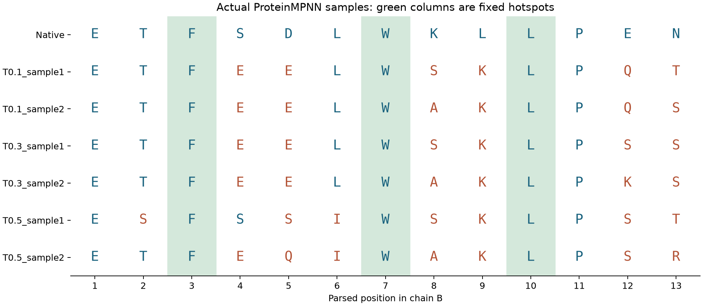

# ProteinMPNN 序列设计：从已知骨架到可检验的肽候选

这一章要完成一件具体的事：以已知的 MDM2–p53 结合结构为起点，生成六条新的候选肽，读懂它们的计算分数，再根据下一轮实验的目的决定值得验证哪些。读完以后，你应当能够从输入文件追到六条序列的来源，也能够解释自己为什么选择某一条，而不是只说“软件给它的分数最低”。

本章的六条序列来自已经完成的 Debian GPU 运行。它们是计算候选，还没有对应的结合、溶解度或细胞实验结果。下面会把“已经得到的结果”和“可以据此安排的下一步实验”分开讲清楚。

## 1. 我们究竟想改造什么

上一章的 HADDOCK3 主要解决肽怎样摆放到受体上的问题。这一章换一个问题：假如结合时的主链位置已经知道，能不能保留这套空间安排，把肽上的部分氨基酸换掉，得到值得验证的新序列？

为减少骨架误差的干扰，本章直接使用实验复合物 1YCR，而没有把上一章某个对接模型接过来。输入中的 A 链是 MDM2 受体片段，有 85 个有坐标的残基；B 链是 13 位的 p53 肽，序列为 `ETFSDLWKLLPEN`。这里的 WT 或母序列都指这条 13 位输入肽，不是全长 p53。

我们希望改变的是肽，所以 A 链的序列保持不变。B 链也不是所有位置都放开：保留第 3 位 F、第 7 位 W、第 10 位 L，让模型设计其余十个位点。这三个保留位置对应原始 PDB 的 F19、W23、L26。可以把本次任务写成下面的样子：

```text
链内位置    1234567890123
母序列 WT   ETFSDLWKLLPEN
保留位置    ..F...W..L...
```

点号表示允许改变，字母表示必须保留。需要注意，肽内位置 3 对应 PDB 的 B19，固定位置参数应该填写 `3 7 10`，而不是 `19 23 26`。

这个设定只规定“哪些位置允许改变”，没有规定“最多改变几个位置”。这是理解后面结果的关键：虽然固定了三个热点，其余十个位点仍可能同时发生多处替换。如果研究目的是只做一个或两个突变，当前任务条件就还不够严格。

## 2. 六条新序列是怎样产生的

ProteinMPNN 接收的是复合物的主链坐标及序列约束。它利用残基周围的空间环境，计算某个位置选择不同氨基酸的条件概率，再逐步抽样组成一条完整序列。已知受体和固定热点为设计提供上下文；已经抽到的氨基酸也会影响后续位置的选择。这就是本例的固定主链序列设计。[ProteinMPNN 方法论文](https://pubmed.ncbi.nlm.nih.gov/36108050/)

例如，一个位置可能较偏好 E，也允许 Q 或 S。生成时程序从相应分布中抽取一个字母，然后继续处理其他位置。它并不是把十个位点所有可能的组合都枚举出来，再挑出全局最好的六条；本章得到的六条只是指定采样设置下的六次输出。

同一骨架能够产生不同序列，是因为抽样和解码顺序包含随机性。本轮还使用了三个采样温度：0.1、0.3 和 0.5。这个温度没有摄氏度或开尔文单位，它调节的是抽样分布：较低值倾向于集中选择模型偏好的氨基酸，较高值给其他选择更多机会。它与之后实验的培养温度、测定温度没有对应关系。

运行参数中，`--num_seq_per_target 2` 与 `--sampling_temp '0.1 0.3 0.5'` 一起决定了样本数：每个温度生成两条，三个温度合计六条。`--batch_size 1` 只是每批处理一条。固定的种子 `20261010` 记录随机起点，模型使用 `v_48_020`；输入、版本、参数和硬件条件也需要保留，不能只凭种子要求不同环境逐字复现。

六条结果出现在 `designs/seqs/1YCR.fa`，不是出现在某个“优化后的结构”文件中。FASTA 第一条是母序列，随后才是六条设计，因此文件共有七条序列记录。这一步没有为六条肽各做一次重新对接或结构预测，保留的结合骨架仍是输入条件。

## 3. 实战：直接调用 ProteinMPNN，生成自己的六条序列

这一节不依赖本教材的运行封装。我们直接使用 ProteinMPNN 官方的三个输入处理程序和 `protein_mpnn_run.py`，把每一步的输入、输出和检查方法展开。下面按顺序操作：`bash` 代码块在终端执行，`python` 代码块作为 Python 代码运行。Python 代码可以保存为 `.py` 文件，再从已激活环境的同一终端执行；这样能够继承前面导出的路径变量。不要把 Python 代码直接粘贴到 Bash 提示符后。

### 3.1 确定工作目录、解释器和模型权重

在解压后的练习仓库根目录打开终端，并激活你已有的、包含 NumPy 与 CUDA PyTorch 的环境，使下面的 `python` 指向它。环境配置见[环境说明](../../docs/ENVIRONMENTS.md)。本节直接调用官方程序，不读取 `config/tools.json`；所以只修改配置文件而不切换当前解释器是不够的。

仓库已经提供 `data/peptide/1YCR_original.pdb` 和固定版本的 `data/aidd/ProteinMPNN/` 源码。首次运行需要取得权重：

```bash
python practice.py fetch proteinmpnn_weights
```

此命令将核验过的权重放到 `data/aidd/ProteinMPNN/vanilla_model_weights/v_48_020.pt`，不会建立环境。输入结构来自 [RCSB 1YCR](https://www.rcsb.org/structure/1YCR)。

接着定义本次练习的路径。`MPNN_CODE` 指向官方源码目录，`MPNN_WEIGHTS` 指向权重所在的目录，`MPNN_WORK` 指向这次运行的工作目录。这里用 `pwd` 得到绝对路径，之后即使官方程序改变内部工作位置，也不会读错文件。

```bash
MPNN_CODE="$PWD/data/aidd/ProteinMPNN"
MPNN_WEIGHTS="$MPNN_CODE/vanilla_model_weights"
MPNN_WORK="$PWD/runs/02_manual"
export MPNN_CODE MPNN_WEIGHTS MPNN_WORK
```

运行下面的 Python 代码：

```python
import os
import sys
from pathlib import Path
import numpy as np
import torch

code = Path(os.environ['MPNN_CODE'])
weights = Path(os.environ['MPNN_WEIGHTS'])
assert (code / 'protein_mpnn_run.py').is_file(), '找不到官方模型入口'
assert (weights / 'v_48_020.pt').is_file(), '找不到模型权重'
assert torch.cuda.is_available(), '本次练习要求 GPU，请先检查现有环境'
print('Python:', sys.executable)
print('PyTorch:', torch.__version__)
print('NumPy:', np.__version__)
print('GPU:', torch.cuda.get_device_name(0))
print('weights:', weights / 'v_48_020.pt')
```

本次 Debian 实际输出如下：

```text
Python: <项目目录>/.venv-analysis-debian13/bin/python
PyTorch: 2.6.0+cu126
NumPy: 2.0.2
GPU: NVIDIA GeForce RTX 3060
weights: <项目目录>/data/aidd/ProteinMPNN/vanilla_model_weights/v_48_020.pt
```

`Python` 确认实际使用的解释器，`PyTorch` 与 `NumPy` 是依赖版本，`GPU` 是可见设备，`weights` 是已通过存在性检查的权重路径。这里把本机根路径简写为 `<项目目录>`；你的路径、版本和显卡名称可以不同，这些占位符不是需要输入的命令。导入库时还可能出现额外警告，以上只展示本段 `print` 的输出。

接着在终端运行：

```bash
mkdir -p "$PWD/runs"
mkdir "$MPNN_WORK"
mkdir "$MPNN_WORK/pdbs"
cp data/peptide/1YCR_original.pdb "$MPNN_WORK/pdbs/1YCR.pdb"
```

这里故意没有对 `MPNN_WORK` 使用 `mkdir -p`。如果目录已存在，先停下来，为新实验换一个目录名，再重新执行路径定义与准备命令，避免把旧结果误当成新结果。当前只复制了一份输入 PDB，没有生成任何新序列。

本章使用常规全主链模型 `v_48_020`，需要 N、CA、C、O 原子的坐标。`v_48_020.pt` 是训练完成的权重文件，不是输入结构；它必须与所用模型类型相符。不要在只有普通模型权重时随意加上 `--ca_only`，也不要把只有 CA 的结构当作完整主链输入。本轮固定源码为 `8907e6671bfbfc92303b5f79c4b5e6ce47cdef57`，PyTorch 为 2.6.0+cu126；学习者应记录自己实际打印出的版本。

### 3.2 检查原始 PDB，弄清链与残基编号

模型读取的是结构文件里的链和坐标，不能只凭文件名认定其中一定有正确的肽。下面直接读 PDB 的 CA 记录，打印 B 链原始编号与解析后位置的对应关系：

运行下面的 Python 代码：

```python
import os
from pathlib import Path

pdb = Path(os.environ['MPNN_WORK']) / 'pdbs/1YCR.pdb'
residues = {}
for line in pdb.read_text().splitlines():
    if line.startswith('ATOM  ') and line[12:16].strip() == 'CA':
        key = (line[21], int(line[22:26]), line[26])
        residues.setdefault(key, line[17:20].strip())
b = [(key, aa) for key, aa in residues.items() if key[0] == 'B']
for position, ((chain, number, insertion), aa) in enumerate(b, 1):
    print(position, chain, number, insertion.strip() or '-', aa)
assert len(b) == 13
assert [b[i-1][1] for i in (3, 7, 10)] == ['PHE', 'TRP', 'LEU']
```

本次 Debian 实际输出如下：

```text
1 B 17 - GLU
2 B 18 - THR
3 B 19 - PHE
4 B 20 - SER
5 B 21 - ASP
6 B 22 - LEU
7 B 23 - TRP
8 B 24 - LYS
9 B 25 - LEU
10 B 26 - LEU
11 B 27 - PRO
12 B 28 - GLU
13 B 29 - ASN
```

每行依次是链内位置、链名、PDB 残基编号、插入码和三字母残基名。`-` 表示该残基没有插入码；例如 `3 B 19 - PHE` 表示 B 链原始编号 19 的苯丙氨酸，是本次解析肽的第 3 位。

输出中，第 1 行对应 B17，第 3 行对应 B19/PHE，第 7 行对应 B23/TRP，第 10 行对应 B26/LEU，最后一行对应 B29。后面固定位置时用第一列的链内位置。换成自己的结构后，不要继续照抄 `3 7 10`，必须重新建立对应关系；缺失残基、插入编号和不同的链名都可能使简单的编号平移失效。

### 3.3 把 PDB 解析成模型能读取的 JSONL

官方解析程序读取一个装有 PDB 的目录。因此我们刚才建立了 `pdbs/`，并只放入本次要设计的 `1YCR.pdb`：

```bash
python "$MPNN_CODE/helper_scripts/parse_multiple_chains.py" \
  --input_path "$MPNN_WORK/pdbs" \
  --output_path "$MPNN_WORK/parsed.jsonl"
```

输入是 `pdbs/1YCR.pdb`，输出是 `parsed.jsonl`。JSONL 是每行一个 JSON 对象的文本格式，本例只有一个结构，所以只有一条记录。记录名称 `1YCR` 来自 PDB 文件名；它将成为后面约束字典的键和输出文件的名称。

不要仅检查文件存在，继续检查程序究竟读到了什么：

运行下面的 Python 代码：

```python
import os
import json
from pathlib import Path
import numpy as np

work = Path(os.environ['MPNN_WORK'])
records = [json.loads(x) for x in (work / 'parsed.jsonl').read_text().splitlines()]
assert len(records) == 1
record = records[0]
assert record['name'] == '1YCR'
for chain in ('A', 'B'):
    seq = record[f'seq_chain_{chain}']
    print(chain, len(seq), seq)
    for atom in ('N', 'CA', 'C', 'O'):
        xyz = np.asarray(record[f'coords_chain_{chain}'][f'{atom}_chain_{chain}'])
        assert xyz.shape == (len(seq), 3)
        assert np.isfinite(xyz).all(), f'{chain} 链 {atom} 坐标不完整'
assert len(record['seq_chain_A']) == 85
assert record['seq_chain_B'] == 'ETFSDLWKLLPEN'
print('输入序列和主链坐标检查通过')
```

本次 Debian 实际输出如下：

```text
A 85 ETLVRPKPLLLKLLKSVGAQKDTYTMKEVLFYLGQYIMTKRLYDEKQQHIVYCSNDLLGDLFGVPSFSVKEHRKIYTMIYRNLVV
B 13 ETFSDLWKLLPEN
输入序列和主链坐标检查通过
```

`print(chain, len(seq), seq)` 的三项输出依次是链名、序列长度和完整序列。因此 `A 85 ...` 表示受体链读到了 85 个残基，`B 13 ETFSDLWKLLPEN` 表示读到了预期的 13 位肽。最后一行只会在所有序列和坐标断言通过后出现；若程序中途报错，不能把已经打印出的两条序列当作检查全部成功。

预期 A 链长度为 85，B 链长度为 13。`seq_chain_B` 保存氨基酸字母串，`coords_chain_B` 内的 `N_chain_B` 等数组保存每个原子的三维坐标。这里的检查要求本例所有主链坐标完整，防止在读错结构或缺失坐标时继续运行。它只证明输入完整，不代表结构的生物学状态一定适合你的研究。

### 3.4 指定只设计 B 链，再固定三个热点

解析文件只告诉模型“结构是什么”，还没有告诉它“哪些位置可以改”。先调用官方链选择程序：

```bash
python "$MPNN_CODE/helper_scripts/assign_fixed_chains.py" \
  --input_path "$MPNN_WORK/parsed.jsonl" \
  --output_path "$MPNN_WORK/chains.jsonl" \
  --chain_list 'B'

cat "$MPNN_WORK/chains.jsonl"
```

预期内容为：

```json
{"1YCR": [["B"], ["A"]]}
```

虽然程序名叫 `assign_fixed_chains.py`，这里的 `--chain_list 'B'` 指的是要设计的链。字典值中的第一组 `['B']` 是设计链，第二组 `['A']` 是固定链。没有提供这份文件时，程序可能设计所有链，因此不能把它当成可有可无的备注。

随后固定 B 链内的三个热点：

```bash
python "$MPNN_CODE/helper_scripts/make_fixed_positions_dict.py" \
  --input_path "$MPNN_WORK/parsed.jsonl" \
  --output_path "$MPNN_WORK/fixed_positions.jsonl" \
  --chain_list 'B' \
  --position_list '3 7 10'

cat "$MPNN_WORK/fixed_positions.jsonl"
```

预期内容为：

```json
{"1YCR": {"B": [3, 7, 10], "A": []}}
```

A 链的位置列表为空，并不表示 A 可以改变，因为上一份文件已经固定了整条 A 链。B 链的列表表示必须保留原身份的位置，其余十位开放设计。JSON 对象中 A、B 的书写顺序不影响这份约束的含义。

最后把两个文件读回来检查，避免文件名或结构键写错后约束没有按预期加载：

运行下面的 Python 代码：

```python
import os
import json
from pathlib import Path

work = Path(os.environ['MPNN_WORK'])
chains = json.loads((work / 'chains.jsonl').read_text())
fixed = json.loads((work / 'fixed_positions.jsonl').read_text())
assert chains == {'1YCR': [['B'], ['A']]}
assert fixed['1YCR']['B'] == [3, 7, 10]
assert fixed['1YCR']['A'] == []
print('设计链 B；固定链 A；固定 B3/B7/B10；可设计位置共 10 个')
```

本次 Debian 实际输出如下：

```text
设计链 B；固定链 A；固定 B3/B7/B10；可设计位置共 10 个
```

这一行是前面四个断言通过后的确认信息。若实际约束与预期不符，程序会先抛出 `AssertionError`，不会打印这条成功提示。

### 3.5 运行官方模型入口

现在输入已经齐全，可以直接运行 ProteinMPNN。下面是生成六条序列的完整命令，不经过教材封装：

```bash
python "$MPNN_CODE/protein_mpnn_run.py" \
  --path_to_model_weights "$MPNN_WEIGHTS" \
  --model_name v_48_020 \
  --jsonl_path "$MPNN_WORK/parsed.jsonl" \
  --chain_id_jsonl "$MPNN_WORK/chains.jsonl" \
  --fixed_positions_jsonl "$MPNN_WORK/fixed_positions.jsonl" \
  --out_folder "$MPNN_WORK/designs" \
  --num_seq_per_target 2 \
  --batch_size 1 \
  --sampling_temp '0.1 0.3 0.5' \
  --seed 20261010 \
  --backbone_noise 0.0 \
  --omit_AAs X \
  --save_score 1 \
  --save_probs 1 \
  > "$MPNN_WORK/design.log" 2>&1
mpnn_status=$?
cat "$MPNN_WORK/design.log"
if [ "$mpnn_status" -ne 0 ]; then
  echo 'ProteinMPNN 运行失败，请先检查日志，不要继续分析。'
fi
```

本次运行日志的关键内容如下，省略了分隔线和导入库时的警告：

```text
pssm_jsonl is NOT loaded
omit_AA_jsonl is NOT loaded
bias_AA_jsonl is NOT loaded
tied_positions_jsonl is NOT loaded
bias by residue dictionary is not loaded, or not provided
discarded {'bad_chars': 0, 'too_long': 0, 'bad_seq_length': 0}
Number of edges: 48
Training noise level: 0.2A
Generating sequences for: 1YCR
6 sequences of length 98 generated in 1.7973 seconds
```

`NOT loaded` 在这里指未提供的可选 PSSM、氨基酸偏置等配置，不是本次必需输入加载失败。`discarded` 三项为零，表示没有因这些检查丢弃输入。`length 98` 指模型处理的完整复合物长度，即受体 85 位加肽 13 位，不能理解成生成了 98 位肽。训练噪声 `0.2A` 来自所选模型，与本次 `--backbone_noise 0.0` 不矛盾。耗时随设备和负载变化，不要求与你的运行一致。

日志被保存到 `design.log`，命令完成后才显示出来；运行期间没有终端输出不代表没有工作。如果退出状态非零，应先解决日志中的问题。官方入口在本版本中自动选择可用的 CUDA，否则回退 CPU，它没有教材封装的 `--device cuda` 参数，所以前面的 GPU 断言很重要。不要把封装脚本的参数直接照搬给官方程序。

三个 JSONL 参数分别传入结构、链选择和位置约束。`--path_to_model_weights` 接受目录而不是 `.pt` 文件，程序会把目录与 `--model_name` 拼成完整权重路径。`--out_folder` 是输出目录，本次为 `designs/`。

样本数由温度数、每个温度的样本数与批大小共同决定。本版代码使用整数除法安排批次，实际总数为 `温度数 × floor(num_seq_per_target / batch_size) × batch_size`。本例为 `3 × floor(2/1) × 1 = 6`。第一次练习保持 `batch_size=1` 最清楚；以后提高批大小时，令每个温度的样本数能被批大小整除。否则，例如设为 5 和 2，每个温度实际只生成 4 条，不能按想象中的 5 条计数。

`--backbone_noise 0.0` 表示本次推理不额外扰动输入骨架；它不同于模型名字所指的训练噪声设置。`--omit_AAs X` 禁止在可设计位置抽取 X 占位符，不禁止标准氨基酸。`--save_score 1` 保存评分数组，`--save_probs 1` 保存逐位概率和序列编码，后者使我们能自己复算分数。两者在本版都是数值开关，必须写出 `1`。

### 3.6 参数怎样根据练习目的修改

为了先验证输入和约束，可以把温度改为 `'0.1'`，每个温度的样本数改为 `1`，只生成一条。这是流程检查，不能用于判断哪种温度更好。要复现本章六条的采样设置，就使用上面的三个温度和每个温度两条。要扩大探索，可以使用如 `'0.1 0.3'` 与每个温度 `20` 条，批大小保持 1，总计 40 条，并另设输出目录。这是下一轮方案示例，不是本章已经完成的结果。

提高温度和增加样本数解决不同问题：前者改变抽样分布，后者增加抽样次数。低温仍可能产生不同序列，高温也可能产生重复序列；生成数不等于独特序列数。不要先大量采样，再发现链或热点约束配置错误。

如果实验目标是只允许肽内第 4、5 位变化，应直接缩小设计范围。下面另写一个约束文件，固定另外十一位，包括三个热点：

```bash
python "$MPNN_CODE/helper_scripts/make_fixed_positions_dict.py" \
  --input_path "$MPNN_WORK/parsed.jsonl" \
  --output_path "$MPNN_WORK/fixed_only_4_5.jsonl" \
  --chain_list 'B' \
  --position_list '1 2 3 6 7 8 9 10 11 12 13'

python "$MPNN_CODE/protein_mpnn_run.py" \
  --path_to_model_weights "$MPNN_WEIGHTS" \
  --model_name v_48_020 \
  --jsonl_path "$MPNN_WORK/parsed.jsonl" \
  --chain_id_jsonl "$MPNN_WORK/chains.jsonl" \
  --fixed_positions_jsonl "$MPNN_WORK/fixed_only_4_5.jsonl" \
  --out_folder "$MPNN_WORK/designs_only_4_5" \
  --num_seq_per_target 2 --batch_size 1 \
  --sampling_temp '0.1' --seed 20261010 \
  --backbone_noise 0.0 --omit_AAs X \
  --save_score 1 --save_probs 1
```

两位点练习的日志末行如下，实际耗时会变化：

```text
2 sequences of length 98 generated in 0.6362 seconds
```

这表示本次生成了两条记录。再运行下面的终端命令，查看这轮独立设计的 FASTA：

```bash
cat "$MPNN_WORK/designs_only_4_5/seqs/1YCR.fa"
```

本次 Debian 实际输出如下：

```text
>1YCR, score=2.4670, global_score=1.5142, fixed_chains=['A'], designed_chains=['B'], model_name=v_48_020, git_hash=unknown, seed=20261010
ETFSDLWKLLPEN
>T=0.1, sample=1, score=0.9985, global_score=1.5106, seq_recovery=0.0000
ETFEELWKLLPEN
>T=0.1, sample=2, score=0.9215, global_score=1.4584, seq_recovery=0.0000
ETFEELWKLLPEN
```

两条设计恰好都是 `ETFEELWKLLPEN`，相对 WT 只改变 S4E、D5E，所以“生成两条”在此只得到一种独特序列。两条相同序列的 score 仍不同，说明生成时不同的解码上下文会影响单次评分；不能把它们当作两种不同分子，也不能只用较低的那次分数代表稳定优势。

这是可选的第二轮练习，应在读完主流程后再执行。它允许第 4、5 位发生替换，但不强迫它们改变，因此相对 WT 最多两个突变，也可能只变一位或完全不变。它不等价于“允许在任意位置挑两个突变”；后者需要建立相应候选库。其设计区域 score 也只平均两个位置，不能与前面十位设计的 score 直接排序比较。

若实验条件明确不希望新增 C，可以使用 `--omit_AAs CX`，保留对 X 的排除同时排除 C；这是人为限制抽样字母，不是模型判断 C 一定不好，也不会删除输入中已固定的 C。设置任何禁用氨基酸、位置限制或骨架噪声时，都应将它记为设计条件的变化，不能继续称为同一组采样。

### 3.7 打开输出，亲手提取序列和分数

主流程成功后，关键文件应为下面这些。模型直接输出的是 FASTA 和 NPZ，并不会自动生成本教材的候选 CSV、审计 JSON 或图表：

```text
runs/02_manual/
  pdbs/1YCR.pdb
  parsed.jsonl
  chains.jsonl
  fixed_positions.jsonl
  design.log
  designs/
    seqs/1YCR.fa
    scores/1YCR.npz
    probs/1YCR.npz
```

先打开 FASTA：

```bash
cat "$MPNN_WORK/designs/seqs/1YCR.fa"
```

本次 Debian 实际输出如下：

```text
>1YCR, score=1.9195, global_score=1.4930, fixed_chains=['A'], designed_chains=['B'], model_name=v_48_020, git_hash=unknown, seed=20261010
ETFSDLWKLLPEN
>T=0.1, sample=1, score=1.2068, global_score=1.4477, seq_recovery=0.4000
ETFEELWSKLPQT
>T=0.1, sample=2, score=1.0887, global_score=1.4078, seq_recovery=0.4000
ETFEELWAKLPQS
>T=0.3, sample=1, score=1.1655, global_score=1.4460, seq_recovery=0.4000
ETFEELWSKLPSS
>T=0.3, sample=2, score=1.2239, global_score=1.4363, seq_recovery=0.4000
ETFEELWAKLPKS
>T=0.5, sample=1, score=1.6291, global_score=1.4914, seq_recovery=0.3000
ESFSSIWSKLPST
>T=0.5, sample=2, score=1.4959, global_score=1.4865, seq_recovery=0.3000
ETFEQIWAKLPSR
```

这里完整列出了母序列和六条设计，而不只是序列字母。后面的提取代码正是从这些表头读取温度、样本号、score、global_score 与 seq_recovery。

以 `>` 开头的是描述行，下一行是序列。第一条描述的是母序列，随后六条才带有 `T=...` 和 `sample=...`。`sample=1` 在不同温度下可以重复，因此记录候选时要把温度和样本号组合起来。输出中的 `git_hash=unknown` 不能证明版本已记录，应另外保存源码版本和权重来源。

下面这段代码直接读取官方 FASTA，生成一个可检查的候选 CSV。它不调用任何教材分析脚本，也明确验证母序列、候选数、长度和热点：

运行下面的 Python 代码：

```python
import os
import csv
from pathlib import Path

work = Path(os.environ['MPNN_WORK'])
records = []
for line in (work / 'designs/seqs/1YCR.fa').read_text().splitlines():
    if line.startswith('>'):
        records.append([line[1:], ''])
    elif line.strip():
        records[-1][1] += line.strip()
assert len(records) == 7, f'预期母序列加六条设计，实际为 {len(records)}'
native = records[0][1]
assert native == 'ETFSDLWKLLPEN'
rows = []
for header, seq in records[1:]:
    fields = dict(item.strip().split('=', 1) for item in header.split(',') if '=' in item)
    assert len(seq) == 13
    assert [seq[i-1] for i in (3, 7, 10)] == ['F', 'W', 'L']
    changes = [f'{a}{i}{b}' for i, (a, b) in enumerate(zip(native, seq), 1) if a != b]
    rows.append({
        'candidate': f"T{fields['T']}_sample{fields['sample']}",
        'sequence': seq,
        'temperature': float(fields['T']),
        'score': float(fields['score']),
        'global_score': float(fields['global_score']),
        'seq_recovery': float(fields['seq_recovery']),
        'mutation_count': len(changes),
        'mutations': ';'.join(changes),
    })
with (work / 'manual_candidates.csv').open('w', newline='') as f:
    writer = csv.DictWriter(f, fieldnames=list(rows[0]))
    writer.writeheader()
    writer.writerows(rows)
for row in sorted(rows, key=lambda x: x['score']):
    print(row['candidate'], row['sequence'], row['score'], row['mutations'])
print('独特序列数:', len({row['sequence'] for row in rows}))
print('已写入:', work / 'manual_candidates.csv')
```

本次 Debian 实际输出如下：

```text
T0.1_sample2 ETFEELWAKLPQS 1.0887 S4E;D5E;K8A;L9K;E12Q;N13S
T0.3_sample1 ETFEELWSKLPSS 1.1655 S4E;D5E;K8S;L9K;E12S;N13S
T0.1_sample1 ETFEELWSKLPQT 1.2068 S4E;D5E;K8S;L9K;E12Q;N13T
T0.3_sample2 ETFEELWAKLPKS 1.2239 S4E;D5E;K8A;L9K;E12K;N13S
T0.5_sample2 ETFEQIWAKLPSR 1.4959 S4E;D5Q;L6I;K8A;L9K;E12S;N13R
T0.5_sample1 ESFSSIWSKLPST 1.6291 T2S;D5S;L6I;K8S;L9K;E12S;N13T
独特序列数: 6
已写入: <MPNN_WORK>/manual_candidates.csv
```

每行依次为候选编号、序列、生成时的 score 和相对 WT 的替换。本段按 score 从小到大打印，所以第二个采样结果排在第一行，顺序不再与原始 FASTA 相同。`S4E` 表示肽内第 4 位由 S 换成 E。这里六次生成恰好得到六条不同序列；`<MPNN_WORK>` 简写你设定的工作目录，实际程序会打印完整路径。CSV 则按原始生成顺序写入，方便下一步与 NPZ 逐条对应。

这一步得到的是生成时记录的分数排序。它既解释每条序列从哪里来，也把六处或七处变化具体写出来。修改样本数后，需要同时修改 `len(records) == 7` 的检查；读取可选的两位点设计时，还要改用它的输出目录。不要为了让代码通过而删除约束检查。

### 3.8 从概率文件复算 score，并检查固定受体

FASTA 只列出设计肽，单看它不能确认 A 链未改变。`probs/1YCR.npz` 保存完整复合物的序列编码 `S`、评分用 `log_probs`、设计掩码 `mask` 和内部链顺序 `chain_order`。下面的代码按保存的链顺序还原完整序列，再检查固定部分并复算分数：

运行下面的 Python 代码：

```python
import os
import csv
import json
from pathlib import Path
import numpy as np

work = Path(os.environ['MPNN_WORK'])
record = json.loads((work / 'parsed.jsonl').read_text().splitlines()[0])
rows = list(csv.DictReader((work / 'manual_candidates.csv').open()))
alphabet = 'ACDEFGHIKLMNPQRSTVWYX'
with np.load(work / 'designs/probs/1YCR.npz') as z:
    print('字段:', z.files)
    S = z['S']
    log_probs = z['log_probs']
    mask = z['mask'][0]
    chain_order = z['chain_order'][0].tolist()
    print('log_probs:', log_probs.shape, 'chain_order:', chain_order)
    assert S.shape == (6, 98)
    assert log_probs.shape == (6, 98, 21)
    assert int(mask.sum()) == 10
    spans = {}
    offset = 0
    for chain in chain_order:
        length = len(record[f'seq_chain_{chain}'])
        spans[chain] = (offset, offset + length)
        offset += length
    assert offset == 98
    b0, b1 = spans['B']
    a0, a1 = spans['A']
    expected = np.zeros(98)
    expected[b0:b1] = 1
    expected[[b0+2, b0+6, b0+9]] = 0
    assert np.array_equal(mask, expected)
    chosen = np.take_along_axis(log_probs, S[:, :, None], axis=2)[:, :, 0]
    scores = -(chosen * mask).sum(axis=1) / mask.sum()
    errors = []
    for encoded, score, row in zip(S, scores, rows):
        full = ''.join(alphabet[int(i)] for i in encoded)
        peptide = full[b0:b1]
        assert peptide == row['sequence']
        assert full[a0:a1] == record['seq_chain_A']
        assert [peptide[i-1] for i in (3, 7, 10)] == ['F', 'W', 'L']
        error = abs(float(score) - float(row['score']))
        assert error < 1e-4
        errors.append(error)
        print(row['candidate'], '重算 NLL:', round(float(score), 6))
    print('最大表头舍入差:', max(errors))
    print('十个设计位置、三个固定热点、固定受体检查通过')
```

本次 Debian 实际输出如下：

```text
字段: ['probs', 'log_probs', 'S', 'mask', 'chain_order']
log_probs: (6, 98, 21) chain_order: ['B', 'A']
T0.1_sample1 重算 NLL: 1.206834
T0.1_sample2 重算 NLL: 1.088693
T0.3_sample1 重算 NLL: 1.165451
T0.3_sample2 重算 NLL: 1.223926
T0.5_sample1 重算 NLL: 1.629111
T0.5_sample2 重算 NLL: 1.495894
最大表头舍入差: 4.8592567443828116e-05
十个设计位置、三个固定热点、固定受体检查通过
```

这六个重算值按原始生成顺序显示。第二条为 `1.088693`，四舍五入后就是 FASTA 中的 `1.0887`。最大误差约为 `0.00004859`，小于代码允许的 `0.0001`；它衡量的是数值复算与表头舍入的一致性，不是预测亲和力的误差。最后一行表示本段所有序列、掩码和分数断言均已通过。

数组中的 6 是候选数，98 是 B 链 13 位与 A 链 85 位的总长度，21 是包括 X 的氨基酸编码类别数。本轮保存的链顺序是 B、A，但代码读取文件中的实际顺序，不假定它永远如此。`mask` 的十个非零位置才是 score 的计分范围。

`take_along_axis` 在每个位点取出候选实际选中字母的对数概率，再乘掩码、求和并除以十，就是后面要解释的 NLL。这里使用 `log_probs`，不是把采样温度处理后的 `probs` 随手取对数。重算值与 FASTA 表头应只差四位小数的舍入误差。

本文中的主流程代码已于 2026-10-27 在现有 Debian GPU 环境中逐段执行：重新生成了下文相同的六条序列，CSV 提取与概率复算通过；另执行了只开放第 4、5 位的示例，确认生成序列没有改变其他位置。示例中的 40 条扩展采样没有执行。

至此，你已经直接调用官方 ProteinMPNN 完成了结构解析、链选择、热点固定、序列生成和输出核验。CSV 是你用上面的代码从官方输出中提取的，不是另一个软件给出的神秘评分。接下来回到已保存的六条 Debian 候选，讨论这些数字与序列差异应怎样用于选择。

为便于讨论，下面按原始输出顺序把它们简称为 C1 至 C6；这些简称只是本章的标签。

```text
WT  ETFSDLWKLLPEN

C1  ETFEELWSKLPQT   T=0.1，sample=1，score=1.2068
C2  ETFEELWAKLPQS   T=0.1，sample=2，score=1.0887
C3  ETFEELWSKLPSS   T=0.3，sample=1，score=1.1655
C4  ETFEELWAKLPKS   T=0.3，sample=2，score=1.2239
C5  ESFSSIWSKLPST   T=0.5，sample=1，score=1.6291
C6  ETFEQIWAKLPSR   T=0.5，sample=2，score=1.4959
```

把 C2 与 WT 对齐，就能看出“设计”实际做了什么。C2 的改变是 S4E、D5E、K8A、L9K、E12Q、N13S，共六处；这里统一采用肽内编号。F3、W7、L10 均保留。其余候选也保留这三个位置，C1 至 C4 各有六处替换，C5 和 C6 各有七处替换。



这说明程序完成了“允许十个位点自由设计”的任务，却没有完成“在 WT 上做少量保守改造”的任务。两者的差别来自我们给程序的问题，而不是程序运行是否成功。

## 4. score 到底在比较什么，为什么越低越好

现在才进入排序。ProteinMPNN 的 score 衡量模型对候选序列与给定结构及上下文相容性的概率判断。它不是 HADDOCK 的能量组合分，也不是结合自由能，没有 kcal/mol 单位。

可以先看一个单独位置。假设模型给最终选中氨基酸的概率为 0.5，那么负自然对数是 `−ln(0.5)≈0.693`；若概率只有 0.1，负自然对数为 `−ln(0.1)≈2.303`。后者受到更大的惩罚，因为模型认为这个选择较不符合当前条件。这两个概率只是解释计算方式的例子，不是本轮某个位点的实际测量值。

程序把可设计位置的这些惩罚取平均，得到负对数似然 NLL，也就是这里的 score：

$$\mathrm{score}=-\frac{1}{10}\sum_{i\in\text{十个可变位置}}\ln p_i(s_i)$$

其中，`s_i` 是候选实际选中的氨基酸，`p_i(s_i)` 是在骨架和相应解码上下文下赋给它的条件概率。分母是十，因为三个强制保留的热点和固定受体不参与这个设计区域平均值。各位置的概率带有上下文条件，并不是十次彼此独立的掷骰子。

因此，C2 的 1.0887 比 C5 的 1.6291 低，表示 C2 在各自保存的评分记录中平均受到的模型惩罚较小。它不能被读成“C2 的亲和力是 1.0887”，也不能由两者相减计算亲和力提高了多少倍。用同样方式看六条记录，暂时的顺序是 C2、C3、C1、C4、C6、C5。

这里的“暂时”有具体原因：每条生成记录的解码上下文与顺序可能不同，本轮又没有为排名提供重复评分的波动范围。C2 与 C3 只相差 0.0768，单凭这个差值无法判断排名是否稳定。正式比较应把 WT 和候选放入同一协议，用共同的多组解码顺序重新评分，查看均值、波动和相对 WT 的差异。[第六章](../06_sequence_optimization/tutorial.md)提供这一操作。当前可以把 C2 作为优先复核的起点，但不能把它宣布为实验上最好的肽。

FASTA 中还有 `global_score` 和 `seq_recovery`。前者平均整个复合物的有效位置，本例共 98 位，包含不参与设计的受体，不能把它当作另一种亲和力评分。后者是十个可变位点中保留 WT 字母的比例，C2 为 4/10，即 40%；这只说明它改变了多少，并不表示“成功率为 40%”。若按全部 13 位算一致性，C2 是 7/13，约 53.8%，因为还包含三个强制保留的热点。

[本轮概率审计](../../examples/proteinmpnn/probability_audit.json)从保存的 `log_probs`、序列编码 `S` 和设计掩码重算了六个 score，与 FASTA 表头的最大差约为 `4.86×10⁻⁵`，符合四位小数的舍入误差；同时确认受体与热点未改变。这证明分数读取和约束执行正确，不是对结合能力的实验验证。[评分实现](https://github.com/dauparas/ProteinMPNN/blob/8907e6671bfbfc92303b5f79c4b5e6ce47cdef57/protein_mpnn_run.py)

## 5. 六条序列怎么比，才不会只得到一个分数排名

首先要问候选是否符合研究范围，再看模型排序。假如项目规定最多两个突变，那么六条候选全部不合格，最低分的 C2 也一样。合理的做法是缩小开放位置或改用有限突变库，并在输出后检查突变数。固定热点本身不能保证突变预算。相反，如果这是一次允许多位点变化的探索性筛选，六条都可以进入下一步比较。

在探索性任务里，候选之间的差异本身也有价值。C2 与 C4 仅在第 12 位不同：C2 为 Q，C4 为 K。若两者采用相同末端形式和测定条件，它们可以组成一个较清楚的 Q12K 比较。C1 与 C3 仅在第 12 位不同，分别为 Q 与 S，也可以形成一组比较。这里讨论的是设计候选之间的差异，不能把其中任何一条称作 WT 的单点突变体。

C2 与 C3 则在第 8 位和第 12 位同时不同。它们可用于比较两种候选组合，但如果实验结果不同，就不能直接断定是 A8S 或 Q12S 中某一个变化造成的。若实验目的是定位某个残基的作用，成对只差一位的候选往往比单纯取分数前两名更容易解释。

还可以从序列中提出需要检查的理化问题。例如，C2 有三个 E、一个 K；C4 有三个 E、两个 K；C5 有一个 E、一个 K；C6 有两个 E、一个 K 和一个 R。用“每个 K/R 记 +1、每个 D/E 记 −1”的粗略侧链计数，它们依次为 −2、−1、0、0。这只是接近中性条件下的简化比较，未计末端及具体 pKa；真实电荷还取决于 pH、末端封闭和局部环境。它不能直接给出溶解度，更不能推出净电荷为零就容易进入细胞。

C5 的 score 在本组最高，但与低温样本的序列模式差异较大。如果目标只是挑模型最偏好的方案，它的优先级可以较低；如果目标是探索不同序列组合，它仍可能提供有用信息。C6 同理。它们不是经过验证的阴性对照：模型评分较差不等于不结合。

因此，“哪个好”至少要说清是哪一种好：模型相容性较好、符合突变预算、便于解释单个变化，或者在指定实验条件下可测且表现较好。前三类可以先从计算结果与设计目标讨论，最后一类需要实验数据补上。不能把它们压成一个没有依据的总分。

## 6. 如果只能合成少数几条，怎样做出具体选择

下面给出一个教学用决策情境，而不是声称本轮已经完成了实验。假设实验室能够做纯化 MDM2 的体外结合测定，允许六处替换，而且预算只够合成三条肽，总数包含 WT。

一个有解释力的起始组合是 WT、C2、C4。WT 提供本次测定条件下的基线；C2 是生成记录中最低分的候选；C4 与 C2 仅差 Q12K，可以检验这一替换在该设计背景下是否改变实验表现。这个组合不意味着 C4 比 C3 更强，而是把有限预算用于“设计是否优于母序列”和“第 12 位的改变是否有影响”两个问题。如果对 Q 与 S 的差异更感兴趣，也可选 WT、C1、C3。正式下单前仍需完成统一重评分、结构复核和可制备性检查；这些结果可能改变提名。

如果目标是扩大搜索，而不要求解释某一个位点，则可以考虑 WT、C2，再加 C5 或 C6 中一条代表不同序列模式的候选。这种方案牺牲了单点归因的清晰度，换取更广的探索范围。预算选择要服务于下一轮想回答的问题，不能机械地把 score 排名前两名拿去合成。

WT 在这里是比较基线，不自动等于能保证实验体系正常的强阳性对照。实验本身仍需要适合该检测方式的背景、体系有效性和特异性对照；不能把“只合成三条候选”的预算示例误读为完整实验所需的全部条件。

## 7. 实验条件会怎样改变候选选择

如果下一步是纯化蛋白的体外测定，首先要保证比较的是定义清楚、能够在同一条件下测量的肽。需要预先明确它们是否采用游离末端、乙酰化或酰胺化形式，是否加标签，以及目标浓度范围、缓冲液 pH、盐浓度和允许的助溶剂比例。这里的重点不是给所有实验套一个固定配方，而是让候选之间具有可比性。

例如，若 C2 在目标缓冲液中无法达到所需可溶浓度，那么即使其 NLL 最低，也不能直接凭名义加样浓度与其他候选比较亲和力。应先检查实际溶解情况和样品质量，必要时调整共同条件或改选可测的候选。上述电荷计数可以提示要关注什么，却不能替代溶解度测量。也不能只给某一条更高比例的助溶剂，然后把检测差异全部归因于序列。

末端形式同样不能省略。1YCR 中截取的 13 位肽来自更长的蛋白片段，单独合成后的末端化学状态是额外的实验选择。末端封闭、荧光标记或其他修饰都改变了被测分子，ProteinMPNN 输出的 13 个字母并没有替我们评估这些修饰。若候选使用不同修饰，就必须把修饰作为另一个变量解释。

检测问题也要区分。直接结合实验关注肽是否与 MDM2 结合以及结合强弱；竞争实验关注它能否在指定体系里替代或阻断探针与 MDM2 的相互作用。前者可能报告 Kd，后者常报告 IC50，二者不能直接混为一个数。相关 MDM2 肽研究分别使用了竞争性荧光偏振、SPR 和 ITC 等方法验证不同层面的结合信息。[原始实验研究](https://pmc.ncbi.nlm.nih.gov/articles/PMC6632053/)

如果下一步直接进入细胞实验，选择标准就必须扩大。候选除了要能结合靶标，还需要在实际暴露条件下保持足够完整、到达细胞内相关位置，并产生与目标机制一致的效应。本章六条线性肽没有这些实测证据，因此无法仅凭 score 或带电残基数选出“最适合细胞”的一条。MDM2 肽的原始研究已经展示了体外亲和力与细胞活性可以脱节，也观察到血清条件会影响表现；这些结论提示应增加相应验证，不能把文献中修饰肽的结果直接套到本章六条序列上。[细胞通透性研究](https://pubs.rsc.org/en/content/articlehtml/2020/sc/c9sc06383h)、[血清与递送条件研究](https://pmc.ncbi.nlm.nih.gov/articles/PMC5431883/)

如果实际条件是“只能做细胞实验，不能先确认结合”，这一限制应该明确写进结论：细胞信号变化可以用于发现候选，但尚不能单独证明某条肽通过预期的 MDM2–p53 竞争机制起效。下一轮需要补足机制证据。若条件允许，先建立体外结合基线，再进入细胞验证，通常更容易判断问题出在序列、递送还是检测环节。

## 8. 本轮能作出的选择，到哪里为止

到这里，可以给本轮结果一个明确结论：三个温度各采样两次，得到六条保留 F3/W7/L10 的新序列；所有候选都符合本次位置约束，但均有六至七处替换。C2 在生成记录中 NLL 最低，适合成为优先复核的起点；如果研究只接受一两个突变，则六条都应退出当前候选集，回到受限设计。

允许多位点探索时，可以先统一重评分并检查候选在结合结构中是否合理，再按实验问题安排组合。例如 WT、C2、C4 是用于比较整体设计效果及 Q12K 差异的一种方案。只有在实际实验条件下得到可解释的结合、竞争或功能结果，才能进一步讨论哪条表现更好。计算在这里帮助提出和缩小问题，并没有提前替实验给出答案。

下一章的动力学练习会继续讨论结构随时间的变化；若你当前最关心如何建立有突变预算的候选库并统一比较，可以接着阅读[第六章：序列优化](../06_sequence_optimization/tutorial.md)。

## 完成手动练习以后，再使用封装入口

理解上述输入与输出后，教材封装可以帮助批量记录日志和生成图表。它把同样的解析、约束和官方推理命令串起来，但不是 ProteinMPNN 本身，也不应代替首次手动练习。直接运行官方程序时，本节的 `manual_candidates.csv` 与旧封装所需的 `candidate_summary.csv` 字段并不完全相同，因此不要把旧分析脚本不加区分地接到手动目录后面；使用本节给出的完整复算代码即可。
