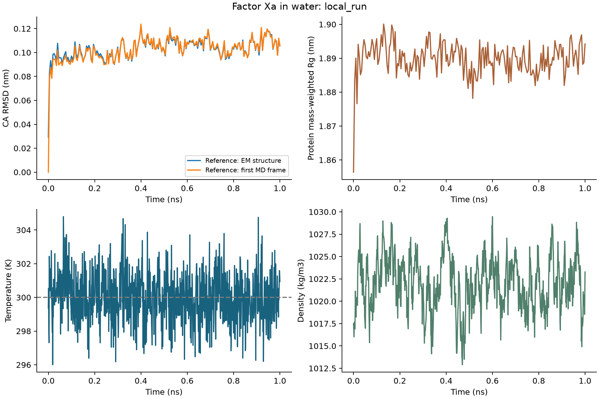

# 分子动力学实战：从 Factor Xa 输入准备到轨迹分析

> 本文对应网站教案的 Debian 版本。仓库练习请先读同目录 [README](README.md)：其中命令使用本仓库目录和可配置工具路径；正文的运行命令已按仓库路径调整；多工具任务统一通过可配置入口执行。


对接和序列设计常常给我们一张结构图。在真实环境中，侧链会转动，主链会摆动，周围的水和离子不断改变位置。因此，当我们问“这个结构能否保持”时，就会想到分子动力学模拟，通常简称 MD。

本章从 GROMACS 官方的 Factor Xa 水溶液案例开始。选择它是为了把准备、平衡、运行和分析学完整。学会这个体系的流程后，再迁移到多肽复合物时，需要针对新的分子组成准备参数和分析对象。

本章采用 Debian GPU 完成的 1 ns 生产轨迹。官方轨迹作为输入方法的参考数据；教学结论依据本轮模拟条件、日志和曲线。

## 1. 从一张坐标表，到一段运动轨迹

结构文件告诉我们原子在哪里，却没有完整说明它们应怎样相互作用。模拟还需要原子的类型、电荷、连接关系和相互作用参数。这些信息由拓扑和力场等共同提供。

力场用近似的数学函数描述势能：共价键拉长、键角偏离、侧链扭转，以及非键原子间的静电和范德华作用，都可能改变势能。程序根据势能随坐标的变化计算力，再以很小的时间步推进坐标和速度。连续保存下来的坐标帧，就是轨迹。

因此，开始运行前需要核对力场与当前分子的化学描述是否匹配。质子化状态、末端、二硫键和非标准残基如果处理错，模拟会在错误的体系上认真计算。

本例使用 CHARMM27 和 TIP3P 水模型，保留官方教程的设置。理解其作用比记住菜单编号更重要：软件菜单顺序可能变化，而你需要确认的是选中了什么物理模型。

从数学上看，力可以写成势能对坐标的负梯度，即 $F=-\nabla U$。某个方向上势能下降得越快，力越倾向把原子推向那个方向。数值积分把这些力转成下一小步的位置和速度，累积后形成轨迹。GPU 加速的是这部分数值计算；它能缩短等待时间，却不会把 1 ns 的轨迹变成更长的物理观察。

这里的势能也不同于结合自由能。势能描述某个瞬间构象的相互作用；结合自由能还涉及结合态、游离态的大量构象及溶剂和熵的变化。因此，看到势能降低，只能先说明当前模型下的几何或相互作用改善。

## 2. 为什么要先给蛋白加水和离子

蛋白周围的水会影响氢键、静电屏蔽和构象。研究水溶液中的蛋白时，水分子和离子也构成模拟体系的一部分。

本例把蛋白放进模拟盒，再填充水并加入离子。最终体系有 11,703 个水分子、38 个钠离子、36 个氯离子，总计 39,600 个原子。这里“盒子”是整个模拟空间，与对接里限制搜索位置的盒子用途不同。

有限盒子会有边界。周期边界条件让盒子在空间中周期重复：粒子离开一边，可以从对应的另一边出现。这个处理方便模拟体相环境，却也为后续轨迹显示和距离计算带来一个问题——同一个分子可能在坐标显示上被切到盒子两侧。

因此，后续分析前要先检查分子的完整性；如果出现异常 RMSD，再回到周期边界与参考处理核对。

## 3. EM、NVT、NPT 与生产段分别解决什么

填充体系后，某些原子可能靠得太近。第一步能量最小化，简称 EM，就是在当前模型下调整坐标，减少这些不合理接触。它通过几何优化降低势能，为随后随时间推进的动力学阶段准备起始结构。体系的平衡情况在后续轨迹中检查。

随后进行 NVT：固定粒子数和体积，控制温度，让体系在指定热条件下调整。再进行 NPT：允许盒子体积随压力控制而变化，使密度等有机会适应。准备完成后，生产段才用于收集我们关心的观察量。

本轮采用 NVT 100 ps、NPT 100 ps、生产 1 ns。ps 是皮秒，1 ns 等于 1000 ps。下文可选手动短程练习只用于拆解命令，结果表均采用本轮 1 ns 实测。

日志也属于结果。本轮 Debian 的 EM 日志没有 LINCS 警告，结束时最大力约为 973.815 kJ·mol⁻¹·nm⁻¹，低于设置的 1000 阈值。这说明达到了本次最小化的停止条件；温度、密度与构象是否适应模拟条件，还要在后续阶段检查。LINCS 是处理键长等约束的算法，若其他运行出现相关警告，应定位发生的阶段和原子，检查初始接触、约束及时间步设置。

## 4. Debian 软件与输入

本轮使用 **GROMACS 2026.4 CUDA 构建**和四个 CPU 线程，分析采用 `.venv-analysis`。

```bash
cd .
# 将自己的 GROMACS 加入 PATH
command -v gmx
gmx --version
```

输入为 `data/md/md-intro-tutorial-main/data/input/1fjs.pdb` 与同目录的 CHARMM MDP。体系采用 CHARMM27、TIP3P，依次经过建模、加水加离子、EM、NVT、NPT、生产模拟。本轮 NVT/NPT 各 100 ps，生产 1000 ps。Factor Xa 与 MDM2/p53 是不同案例，不能把本章轨迹当作 p53 候选的稳定性证据。

## 5. 完成 GPU 全时长运行，再拆解操作

在教材根目录执行：

```bash
python scripts/run_md.py \
  --gmx gmx \
  --output runs/03_my_md_full --threads 4 --gpu --full
```

脚本从官方结构开始，依次清理、建立拓扑、定义盒子、加水加离子、最小化、NVT、NPT 和生产模拟。结果保存在新目录 `runs/03_my_md_full/`；终端按阶段打印进度，每一步的完整日志保存到 `logs/`。

先检查这三项：`commands.json` 记录实际命令与交互选择；`run_summary.json` 的 `complete` 为真；`md.xtc`、`md.edr`、`md.tpr` 和 `md.log` 已生成。然后进入第 7 节分析自己的轨迹。

下面把这条流程拆开。希望手动执行时，另建 `my_md_manual`；按完整脚本运行后，也可以对照自己的 `commands.json` 阅读这些命令。

### 5.1 准备一份可手动执行的输入目录

以下是可选的手动短程练习，不是本轮结果表所用的配置。代码读取官方参数生成短程版。它保持力场相关参数，设置 NVT/NPT 各 10 ps、生产 20 ps，并把生产坐标的保存间隔设为 50 步。

```bash
python - <<'PY'
from pathlib import Path
import re

source = Path('data/md/md-intro-tutorial-main/data/input')
work = Path('runs/03_manual')
work.mkdir(parents=True, exist_ok=False)
pdb = (source / '1fjs.pdb').read_text()
(work / 'protein.pdb').write_text('\n'.join(
    line for line in pdb.splitlines()
    if not line.startswith(('HETATM', 'CONECT'))
) + '\n')

def set_value(text, key, value):
    pattern = rf'(?mi)^\s*{re.escape(key)}\s*=.*$'
    line = f'{key} = {value}'
    return re.sub(pattern, line, text) if re.search(pattern, text) else text + '\n' + line + '\n'

for stage, filename in [('em', 'emin-charmm.mdp'), ('nvt', 'nvt-charmm.mdp'),
                         ('npt', 'npt-charmm.mdp'), ('md', 'md-charmm.mdp')]:
    text = (source / filename).read_text()
    if stage != 'em':
        duration_ps = {'nvt': 10, 'npt': 10, 'md': 20}[stage]
        dt = float(re.search(r'(?mi)^\s*dt\s*=\s*([\d.]+)', text).group(1))
        text = set_value(text, 'nsteps', round(duration_ps / dt))
        for key in ('nstlog', 'nstenergy', 'nstxout-compressed'):
            text = set_value(text, key, 50)
    if stage == 'nvt':
        text = set_value(text, 'gen_seed', 20261010)
    (work / f'{stage}.mdp').write_text(text)
ions = set_value((source / 'emin-charmm.mdp').read_text(), 'coulombtype', 'Cut-off')
(work / 'ions.mdp').write_text(set_value(ions, 'nsteps', 0))
PY
cd runs/03_manual
```

本案例构建蛋白水溶液体系，因此按官方入门路线去掉 HETATM 和 CONECT。新靶点若依赖金属、辅因子或配体，应先确定保留方式并准备对应参数。

参数里 `dt=0.002` 的单位是 ps，即 2 fs。10 ps 对应 5,000 步，20 ps 对应 10,000 步。`nstxout-compressed=50` 表示每 50 步保存一帧，间隔是 0.1 ps；连同初始帧，本例生产段得到 201 帧。

### 5.2 从坐标生成拓扑，定义盒子，再填充水

从这一小节到 5.5，终端都停留在 `runs/03_manual`：

```bash
gmx pdb2gmx -f protein.pdb -o processed.gro -p topol.top \
  -ff charmm27 -water tip3p -ignh
gmx editconf -f processed.gro -o box.gro -c -d 1.0 -bt dodecahedron
gmx solvate -cp box.gro -cs spc216.gro -o solv.gro -p topol.top
```

第一步给蛋白分配原子类型、电荷和连接，按所选力场重新生成氢。查看识别到的链、残基、末端和二硫键；本案例的默认交互选择已保存在完整脚本的 `commands.json` 中，手动时核对提示再选择。

第二步把蛋白放到十二面体周期盒中心，`-d 1.0` 是蛋白到盒边的间隔，单位 nm。第三步填充水坐标，并更新拓扑中的水分子数。`spc216.gro` 提供填充坐标，水的实际相互作用参数由 TIP3P 拓扑定义。

### 5.3 加离子：为溶液设置电荷与盐条件

```bash
gmx grompp -f ions.mdp -c solv.gro -p topol.top -o ions.tpr
gmx genion -s ions.tpr -o solv_ions.gro -p topol.top \
  -pname NA -nname CL -neutral -conc 0.15 -seed 20261010
```

`genion` 提示选择替换对象时，选择 **SOL 水分子组**。`-neutral` 中和净电荷，`-conc 0.15` 设置名义盐浓度；实际离子数还受盒子体积与离散取整影响。具体离子数以各自建模日志为准。

`ions.mdp` 以零步生成供换离子使用的 TPR。后面的最小化和动力学分别使用自己的参数文件，其中保留官方 PME 长程静电设置。

### 5.4 先最小化，再进行温度与压力调整

```bash
gmx grompp -f em.mdp -c solv_ions.gro -p topol.top -o em.tpr
gmx mdrun -deffnm em -ntmpi 1 -ntomp 4
gmx grompp -f nvt.mdp -c em.gro -r em.gro -p topol.top -o nvt.tpr
gmx mdrun -deffnm nvt -ntmpi 1 -ntomp 4
gmx grompp -f npt.mdp -c nvt.gro -r nvt.gro -t nvt.cpt -p topol.top -o npt.tpr
gmx mdrun -deffnm npt -ntmpi 1 -ntomp 4
```

`-deffnm em` 让本阶段文件统一以 `em` 开头；`-ntmpi 1 -ntomp 4` 使用一个线程 MPI rank、四个 OpenMP 线程。`-r` 提供位置限制的参考坐标，`-t` 从 checkpoint 继承速度等状态。

EM 结束后先查最大力与局部几何。NVT 看温度随时间的变化，NPT 再检查密度、体积与压力；看到 LINCS 警告时，结合发生阶段、结构冲突和步长排查。完整脚本按这个顺序保存各阶段日志。

### 5.5 生产段：收集需要分析的轨迹

```bash
gmx grompp -f md.mdp -c npt.gro -t npt.cpt -p topol.top -o md.tpr
gmx mdrun -deffnm md -ntmpi 1 -ntomp 4
gmx check -f md.xtc
```

这份可选手动练习的生产段为 20 ps；本轮已完成的 GPU 结果为 1 ns。`gmx check` 应显示轨迹时间与帧数；`.xtc` 保存坐标，`.edr` 保存能量等时间序列，`.cpt` 提供续跑状态，`.log` 记录计算与诊断。

想按官方原时长运行时，可在教材根目录执行完整脚本并加 `--full`，另设结果名；它使用官方 NVT 100 ps、NPT 100 ps、生产 1 ns 参数。无论时长如何，最终都要根据观察量判断平衡与采样情况。

## 6. 先看参数，再决定怎样分析

在开始画图前，逐项确认下列设置：

先核对势能模型：CHARMM27 与 TIP3P 分别参与定义蛋白和水的相互作用；PME 与非键截断规定怎样处理长、短程作用，需要与力场及盒子设置相容。它们决定这段模拟采用什么近似。

再核对时间和控制条件。`dt` 乘 `nsteps` 得到模拟覆盖的物理时间；300 K 和 1 bar 是温压耦合的目标，实际是否适应这些条件要看时间序列。平衡阶段的位置限制还会抑制部分坐标移动，因此不能把受限阶段的低波动直接解释为分子天然稳定。

最后核对分析定义。本章以完整 EM 结构为参考，按选定 Cα 原子拟合和测量。换参考、换原子集合或换拟合对象，都可能改变 RMSD，即使轨迹文件完全相同。


这些设置把一条曲线与一个具体物理问题联系起来。接下来先处理周期边界，再对照结构与热力学读数。

## 7. 分析自己的运行：显式指定轨迹目录

回到教材根目录执行。下面的 `--local-run` 指向第 5 节完整脚本产生的 `my_md_full`；手动路线则改为 `my_md_manual`。

```bash
cd '.'
python scripts/analyze_md.py \
  --gmx gmx \
  --local-run runs/03_my_md_full \
  --output runs/03_my_md_analysis
```

程序分别处理官方 1 ns 与自己的轨迹。新模拟的分析写入 `my_md_analysis/local_run/`，官方比较写入 `official_1ns/`。新输出目录让输入绑定清楚；若已有分析目录指向其他轨迹，程序会提示冲突。

过程依次恢复完整分子、消除跨边界跳跃、居中，再计算 RMSD、RMSF、Rg 和温压密度。输出包括 `structural_metrics.csv`、`thermodynamics.csv`、`trajectory_analysis.png` 和总的 `analysis_summary.json`。日志记录每次交互选择，MDTraj 还会独立复算 RMSD。

若要手动看一次指标提取，在自己的模拟目录可以执行：

```bash
gmx energy -f md.edr -o thermodynamics.xvg
```

按提示选择 `Temperature`、`Pressure`、`Density`，输入 `0` 结束选择。程序会给出平均值等统计。解释前确认单位、时间区间和平衡阶段；接着按下面的真实图表学习怎样读这些结果。

### 7.1 Debian GPU 实测记录

2026-10-23 完成 NVT 100 ps、NPT 100 ps、生产 1 ns。全部步骤约 471 秒，生产轨迹 201 帧，间隔 5 ps。GPU 非键相互作用、PME 与更新卸载情况见实际 mdrun 日志。

[运行记录](../../examples/md_run_metadata/run_summary.json)、[分析摘要](../../examples/debian13_20261023/md_analysis/analysis_summary.json)、[生产日志](../../examples/md_run_metadata/md.log)。独立 RMSD 复核最大差为 4.93×10⁻⁶ nm。

## 8. 先看时间轴，再看曲线



生产段长 1000 ps，共 201 帧。帧数本身不表示采样充分；帧间相关性、平衡区间和独立重复会影响有效样本量。

本轮蛋白 Cα 相对 EM 的平均 RMSD 为 0.103076 nm，Rg 为 1.889838 nm。RMSD 描述选定参考和原子集合的偏移，RMSF 描述逐残基波动，Rg 描述紧凑程度。应把三者与温度、压力及轨迹可视检查结合。

RMSD 的计算可以理解为：把指定原子与参考逐一对应，先消除选定拟合组的整体平移和转动，再对剩余距离平方取平均、开方。0.103076 nm 约为 1.03 Å；它是这套参考和选择下的轨迹均值，不是每个原子都恰好移动了这么远。

RMSF 把问题改成“每个残基围绕自己的平均位置摆动多大”，因此更适合定位波动集中在哪里；Rg 则概括原子相对整体中心的分散程度。蛋白可能在 Rg 几乎不变时发生局部重排，也可能在总体 RMSD 平缓时出现关键接触断裂。三种观察量相互补充，不能互相替代。

曲线出现平台，说明该指标在这一时间窗口内没有继续明显漂移。分子也可能停留在尚未离开的局部构象里；每 5 ps 保存一帧的 201 帧之间还存在时间相关性，不能当成 201 次独立实验。要评价更慢的变化，需要根据问题增加模拟时间、独立起点与重复，并检查分块统计是否一致。

## 9. 怎样排查异常 RMSD：先检查比较对象

如果某次分析得到异常大的 RMSD，排查时先检查坐标和参考的处理方式。周期边界可能把结构分到盒子两侧，参考和轨迹的处理不一致，也会导致比较对象失真。

合理顺序是先把分子恢复完整，检查居中与跨边界跳跃，再确定拟合组、测量组和参考。本轮使用 GROMACS 与 MDTraj 在同一完整参考下独立计算，结果差异很小。这一步验证了两套分析实现的一致性。物理模型与实验的吻合程度，则要用相应的实验观察量进一步评价。

这一点迁移到蛋白–肽模拟尤其重要。若先把肽单独拟合到参考肽，再计算它的 RMSD，即使它整条漂离受体，内部形状仍可能很像。研究结合姿态时，应考虑先拟合受体，再测量肽相对受体的变化，并结合界面接触一起看。

## 10. 联合读取温度、压力与结构

本轮生产 1 ns 的 Cα 平均 RMSD 为 0.103076 nm，平均 Rg 为 1.889838 nm。温度均值为 299.996 K，压力均值为 −0.169 bar，密度均值为 1021.998 kg/m³。它们分别描述结构偏移、紧凑程度和体系的热力学观察量，需要结合各自时间曲线解释。


这些值来自全部记录区间，没有独立重复误差。压力会有较大瞬时涨落，不能只凭一个均值判断平衡。教学 1 ns 轨迹用于学习流程与指标，可靠的构象采样或结合稳定性结论还需针对研究问题设计更长模拟与重复。

## 操作中遇到的问题

运行入口找不到 `gmx` 时，先检查 PATH 并执行 `gmx --version`，确认调用了预期程序。若 `grompp` 报残基或参数错误，问题通常已经出现在化学身份、缺失坐标或力场支持上，应先修正输入，再进入动力学。

进入运行后，LINCS 警告需要结合阶段、原子冲突、约束和时间步检查；异常 RMSD 则先核对周期边界、参考、原子映射和拟合组。如果图实际对应旧轨迹，用 `--local-run` 重新绑定输入，并用 `--output` 保存独立分析目录，使文件与结论重新对应。


## 读完后，试着自己解释

如果有人给你一条平稳 RMSD 曲线并说“它证明结合很强”，你应先询问体系、参考、拟合组、时间和相关接触。很短时间里没有离开初始状态，可能只是还没采到变化；估计 Kd 还需要适合结合平衡的实验或自由能计算。

本章的关键成果是学会检查轨迹证据。原始摘要见 [analysis_summary.json](../../examples/debian13_20261023/md_analysis/analysis_summary.json)，方法来自 [GROMACS 官方教程](https://tutorials.gromacs.org/docs/md-intro-tutorial.html)。接着读[CAR-T 案例](../04_cart/tutorial.md)，看真实实验中为什么“某项指标更好”也不等于整体功能更好。
