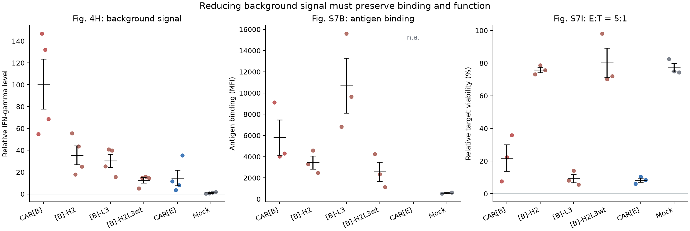

# CAR-T 数据分析实战：从论文原始表到工程判断

> 本文对应网站教案的 Debian 版本。仓库练习请先读同目录 [README](README.md)：其中命令使用本仓库目录和可配置工具路径；正文的运行命令已按仓库路径调整；多工具任务统一通过可配置入口执行。


想象你在优化一个 CAR 构建。它在没有靶抗原的时候就产生较强背景信号，因此你修改识别头，希望让它安静下来。修改后，背景确实下降了。这个结果听起来很好，但如果细胞遇到靶标时也不再有效响应，优化就失去了意义。

本章用一篇真实研究的公开原始数据，顺着这个问题学习 CAR-T 工程判断。研究来自 Sarén 等发表于 Nature Communications 的论文：[Complementarity-determining region clustering may cause CAR-T cell dysfunction](https://www.nature.com/articles/s41467-023-40303-z)。本章从附件和面板布局开始，带你提取公开数据、核对单元格、重算统计并作图，再解释识别头工程中的功能权衡。

## 1. 先把一个 CAR 从外到内看明白

CAR 的胞外识别头负责识别目标抗原，经由铰链和跨膜区与胞内信号区连接。发生合适的识别事件后，信号区将其转化为 T 细胞内的响应。本研究采用含 4-1BB 与 CD3ζ 的第二代 CAR。

识别头可以有不同形式。本文使用 scFv：把抗体重链与轻链的可变结构域 VH、VL 连接起来。它有重链和轻链各三个 CDR，分别记作 H1–H3、L1–L3。CDR 是抗原识别中高度可变的区域，框架则支持整体结构；CDR 与框架共同影响折叠和相互作用，分析突变时需要同时考虑两部分的结构环境。

你之前的 BoltzGen 案例使用 VHH，它是单个重链可变结构域，有三个 CDR。下面的 L3 专指 scFv 的轻链 CDR3；迁移到 VHH 时，需要按 VHH 的编号和结构重新确定设计位置。

本研究比较面向 IL13Rα2 的不同 CAR 识别头。它们共享框架背景，CDR 有差异。这样可以观察识别区域的变化怎样关联到表达、背景和功能，将结果用于其他 CAR 时，需要在对应构建和实验条件下重新评价。

这也解释了为什么结构设计不能直接替代 CAR 功能筛选。可溶识别头的结合发生在溶液中，完整 CAR 则受到膜上密度、朝向、铰链长度和胞内信号模块的共同影响。同一识别头接到不同受体骨架上，可能得到不同背景与功能。比较识别头时，应尽量固定这些下游条件，才能把差异与所研究的修改联系起来。

## 2. 为什么会出现“没有靶标也有信号”

理想情况下，我们希望 CAR 在遇到目标时产生合适响应。然而膜上的受体如果发生不合适的聚集，也可能在没有抗原刺激时产生背景激活。研究里常把这类现象称为 antigen-independent tonic signalling，即不依赖抗原的持续背景信号。

研究这个现象，需要同时观察三个方面：膜上有没有表达 CAR？无抗原时是不是已经活跃？有靶细胞时还能不能产生需要的功能？

本章会遇到两个缩写。MFI 在这篇论文中指平均荧光强度，帮助描述某个门控细胞群里的染色信号；IFN-γ 是细胞因子，其无刺激条件下的读数可用于观察背景活化。亲和力由结合测定评价，杀伤功能则需要靶细胞存活等功能读数。

表达量是否影响背景，可以通过比较不同构建的数据来检查。原研究中，一些构建表达较高而背景较低，提示需要进一步结合膜分布、信号检测和干预实验。膜分布和干预实验有助于进一步区分这些机制。

“聚集”和“功能障碍”的联系也需要逐层判断。无刺激 IFN-γ 升高提示存在背景响应，但单个读数不能独自确认聚集的分子机制；还应结合受体分布、表达和干预实验。背景持续激活可能改变细胞状态，然而某次共培养杀伤变差，也可能涉及抗原识别、表位可达性或表达。把这些原因分开检验，才能避免把相关性写成已确定的因果关系。

## 3. 使用现有分析环境，定位原始数据

```bash
cd .
source .venv-analysis/bin/activate
python -c 'import openpyxl, pandas; print(openpyxl.__version__, pandas.__version__)'
```

两份原始 Source Data 工作簿位于 `data/cart/`。openpyxl 读取单元格，pandas 整理逐观测表，Matplotlib 绘图。`source_manifest.json` 保存官方来源和指纹，分析不改写原始工作簿。

区分论文面板、分组和重复。可视上相邻的点不自动表示同一供者；来源没有明确配对关系时，保留供者未知状态。

## 4. 把一个面板变成数据：先定位标签与数值

以主图的 `Figure 4` 为例，J 列提供分组标签，K 列存放 Fig. 4H 的相对 IFN-γ。下面打印真实单元格，观察组名如何出现：

```bash
python - <<'PY'
from openpyxl import load_workbook

workbook = load_workbook('data/cart/Source data - Main figures.xlsx',
                         read_only=True, data_only=True)
sheet = workbook['Figure 4']
for row in range(2, 26):
    print(f'J{row}:', sheet[f'J{row}'].value,
          f'K{row}:', sheet[f'K{row}'].value)
workbook.close()
PY
```

你会看到一个组名下面有多个数值。标签通常只写在该组第一行，后续空标签行仍属于同组。因此提取时要记住当前组名，并为每个数值保存原单元格；填充分组的范围由这个面板的边界决定。

本章脚本使用以下已核对范围：

主工作簿 `Main` 中，`Figure 1` 的 A/B、D/E 列第 2–31 行对应 1E、1F 的靶细胞相对存活；`Figure 2` 的 A/B 列第 2–19 行对应 2B 表面表达 MFI，G/H 列第 2–25 行对应 2I 无刺激 IFN-γ。2I 源区域的单位仍需核验，提取时保留这一状态。

`Figure 4` 的 A/B 列第 2–29 行对应 4C 转导群体中的 CAR 阳性比例，J/K 列第 2–25 行对应 4H 相对 IFN-γ。补充工作簿 `Supplementary` 的 `Fig. S7` 中，D/E 列第 2–15 行用于 S7B 抗原结合 MFI；S7I 的组名在第 22 行，数值在第 23、24 行，分别从 E/H/K/N/Q/T 开始各取三列，对应两个 E:T 条件下的相对存活。


提取器针对这些位置建立规则。以后换一篇论文，应先检查其附件布局，再写新的面板映射。

## 5. 运行提取与绘图，保留自己的结果目录

在教材根目录执行：

```bash
python scripts/extract_cart_data.py \
  --data data/cart --output runs/04_my_cart
python scripts/plot_cart.py \
  --input runs/04_my_cart/source_observations.csv \
  --output runs/04_my_cart
```

第一步逐面板读数，为每个观测写入工作簿、sheet、分组、指标、单元格和供者标识状态；再按“面板＋指标＋组名”汇总。第二步读取这次提取的 CSV，画出原始点、均值和 SEM。

提取后先打开 `source_observations.csv`，它保存 204 个观测及各自源单元格，再查看 `panel_summary.csv` 中 49 个分组的 n、均值、样本 SD、SEM 和范围。`extraction_summary.json` 记录读取状态、sheet 信息和分析范围，帮助判断有没有遗漏面板。

在此基础上，`mutation_tradeoffs.png` 比较背景、结合和功能；`target_background_comparison.png` 展示同一组 CAR 在两类靶细胞中的表现；`expression_and_background.png` 连接表面表达与无刺激背景。先验收逐观测表，再读图，可以追溯图中每一个点。


先查看计数，再去看图：

```bash
python - <<'PY'
import csv
import json
from pathlib import Path

run = Path('runs/04_my_cart')
summary = json.loads((run / 'extraction_summary.json').read_text())
print('Observations:', summary['observations'])
print('Panel groups:', summary['panel_groups'])
for row in csv.DictReader((run / 'panel_summary.csv').open()):
    if row['panel'] in ('4H', 'S7B', 'S7I_5:1') and row['group'] in ('[B]-L3', '[B]-H2L3wt'):
        print(row['panel'], row['group'], 'n=', row['n_source_observations'],
              'mean=', round(float(row['mean']), 3))
PY
```

应得到 204 个观测和 49 个分组。L3 与 H2L3wt 在这三个面板中的 n 分别是 4、3、3。若计数不符，先核对工作簿、sheet、面板范围和数值类型，再检查分组填充。

## 6. 亲手重算一个均值与误差条

下面从自己提取的观测表中选出 Fig. 4H 的 L3，直接计算平均值、样本 SD 与 SEM：

```bash
python - <<'PY'
import csv
import math
import statistics
from pathlib import Path

path = Path('runs/04_my_cart/source_observations.csv')
rows = list(csv.DictReader(path.open()))
selected = [row for row in rows if row['panel'] == '4H' and row['group'] == '[B]-L3']
values = [float(row['value']) for row in selected]
sd = statistics.stdev(values)
print('n:', len(values))
print('Mean:', statistics.mean(values))
print('Sample SD:', sd)
print('SEM:', sd / math.sqrt(len(values)))
for row in selected:
    print(row['source_book'], row['source_sheet'], row['source_cell'], row['value'])
PY
```

均值约为 **30.372**。样本 SD 使用 `n−1` 分母，SEM 再用 SD 除以 `√n`。图中原始点展示观测分布，误差条展示均值的统计量，两者一起看才能了解离散程度。

这里的 `n_source_observations` 记录源数值个数。供者配对和独立性需要实验设计与元数据支持；当前表将未提供的供者标识保留为 `not_provided`。本章按各面板做描述性汇总，跨面板比较时同时交代这个信息。

### 6.1 Debian 实测记录

2026-10-23 从原始工作簿提取 204 个观测、49 个分组，并生成三张图。源单元格、分母及供者状态保存在[逐观测表](../../examples/debian13_20261023/cart/source_observations.csv)，统计见[分组表](../../examples/debian13_20261023/cart/panel_summary.csv)。本章采用这些 Debian 派生结果。

## 7. 先把三类读数各自读对

我们从 CAR[B] 及其 CDR 修改入手。H2 表示涉及重链 CDR2 的修改，L3 表示涉及轻链 CDR3 的修改。H2L3wt 是另一个双区域方案，使用相应的原始库序列设计，具体改动需按其构建序列逐位核对。完整构建以原论文序列为准。

在下面的结果里，“背景”是无刺激条件下的相对 IFN-γ；“抗原结合 MFI”是给定染色条件下的结合相关荧光；“靶细胞存活”是共培养后的归一化读数。第三项越低，表示该条件下剩余靶细胞信号越少。

作为基线，CAR[B] 的无刺激相对 IFN-γ 均值为 100.657，抗原结合 MFI 为 5812，相对靶细胞存活为 21.885%。H2 修改后，这三个读数分别为 35.474、3454 和 75.835%：背景降低的同时，当前条件下的靶细胞清除表现也变弱。

L3 的对应值为 30.372、10695 和 9.289%，在降低背景的同时保留了较好的结合相关及功能表现。H2L3wt 的背景进一步降低到 12.657，结合 MFI 却为 2577，靶细胞相对存活升至 80.131%。这组对照把工程取舍呈现出来：若只按背景最低提名，就可能错过更符合整体目标的构建。


这些是公开原始数据重算的均值。背景面板 n=4，结合面板 n=3，存活面板 n=3；存活来自 E:T=5:1 的条件，E:T 表示效应细胞与靶细胞的数量比。这些读数来自不同面板，当前源数据缺少可确定的跨面板供者匹配，因此这里按各面板分别汇总。

## 8. 顺着一个错误选择，把优化问题看清

如果你只按第一列“背景最低”选择，会选 H2L3wt。它的背景约 12.657，比 L3 的 30.372 更低。但再看功能列：H2L3wt 的靶细胞相对存活约 80.131%，L3 约 9.289%。在该测定条件下，最低背景并没有对应最好的目标细胞清除表现。

再看结合 MFI，H2L3wt 约 2577，L3 约 10695。这个读数提示两种构建的抗原结合相关表现也不同。MFI 同时受表达量、染色条件、门控和膜上多价效应影响。要获得一对一结合 Kd，需要使用适当的结合测定和拟合模型。



读图时，沿着同一构建跨过各个面板，观察降低背景的同时保留了哪些结合与功能表现。L3 在这里值得继续研究，是因为它在降低背景的同时仍有较好的结合相关读数和功能表现。这个结论限于当前数据与条件，进一步选择还需要其他证据。

前面序列优化里的多目标思路，在这里就有了实验对应：单项改善可能以另一项变差为代价。理解各目标的生物学含义后，才能决定如何权衡这些变化。

## 9. 为什么“百分比”也要先问分母

论文中的相对靶细胞存活，以共培养后的靶细胞荧光素酶信号相对无 T 细胞对照归一化。它可能受增殖和测量变化影响，甚至超过 100%。分析时应保留超过 100% 的原始值。`100−相对存活` 表示相对信号的减少；若要得到细胞死亡比例，还需适合该问题的测定与校准。

类似地，“GFP+ 中 CAR+ 的比例”与“全培养物中 CAR+ 的比例”分母不同。GFP 在这里用于标记转导相关群体；前者描述已转导相关群体的表面呈现情况，整个培养物的转导效率则使用全培养物作为分母。

把分母写清楚，才能区分制造效率、表面呈现和识别功能，找到需要优化的具体环节。

举一个只用于理解归一化的算例：若无 T 细胞对照的发光信号是 1000，共培养后是 800，相对存活就是 80%。这表示归一化信号剩下八成；如果信号与细胞数之间存在非线性、细胞增殖或单位细胞发光改变，就不能直接把 20% 的信号减少叫作 20% 细胞死亡。真实数值的解释必须跟随测定原理。

同样，结合 MFI 增高可能来自每个受体的结合增强，也可能来自表面受体更多或多价效应。它适合在统一染色和门控下比较表型；若问题是单分子亲和力，就要转向能够得到结合曲线及动力学参数的测定。

## 10. 平均值以外，还需要看哪些信息

同一个均值可能来自很集中或很分散的观测。SD，即标准差，描述观测的离散程度；SEM，即均值标准误，描述均值估计的精度。在适当的独立重复条件下，SEM=SD/√n，所以增加 n 可以让 SEM 变小，却不表示供者之间的差异缩小了。

技术重复与独立供者也不同。同一份生物样本测三次，可以帮助了解测量波动，这些测量仍属于同一生物样本。因此，确定 n 时要依据独立实验单位。

本教材的分析范围是描述性统计和图形重绘。比较均值可以提出问题和形成假设；要做新的推断，还需要明确独立性、配对关系与比较方案。

SEM 小不等于构建之间已经存在可靠差异。如果 n 是同一供者的多个技术孔，把它们当作独立生物重复会高估精度。当前公开表能够支持逐面板描述和工程假设；新的显著性检验需要额外确认独立单位、配对关系及预先定义的比较。先把这些信息补齐，比直接套一个检验名称更有意义。

## 11. 如果换成自己的识别头，怎样推进

先尽量固定下游 CAR 骨架和实验条件，再比较识别头，避免多个模块同时变化后无法归因。检查顺序可以围绕问题展开：分子是否制备正确，是否有目标识别，能否在膜上呈现，无目标时是否异常活跃，遇到目标后是否有合适功能。

如果可溶性结合看起来不错，CAR 功能却很差，可以沿着功能形成的过程检查抗原表达、阴性对照、膜上呈现、表位可达性、背景与细胞状态。一个可溶 binder 与装在细胞膜上的识别头，工作环境不同。

## 操作中遇到的问题

工作簿读取失败时先核对文件来源、sheet 名和依赖；若分组数量或均值不符，回到原始单元格检查面板边界、空标签的继承范围及数值类型。不要为了让结果接近论文图而手工改写源数值。

误差条异常时，先核对 n 和 SD/SEM 定义，再查是否混入技术重复或错误配对。遇到超过 100% 的相对存活，保留原值并检查归一化分母。跨面板无法匹配供者时，分别汇总，不能靠行号相邻自行建立配对。


## 读完后，试着自己解释

用 L3 与 H2L3wt 回答：“为什么不选背景最低的构建？”完整回答应指出背景、结合相关读数和功能是三层证据，并引用当前条件下的实际差异。

再回答：“你如何保证重绘图可信？”应能找到一个点的来源，解释单位和分母，说明供者匹配信息的完整程度，以及本次分析采用的统计方法。你现在拥有的是一份可追溯的公开数据分析案例。

下一课读 [GNINA 小分子对接](../07_gnina/tutorial.md)，把“先弄清对象和指标，再评价结果”的思路带到另一类分子任务。
