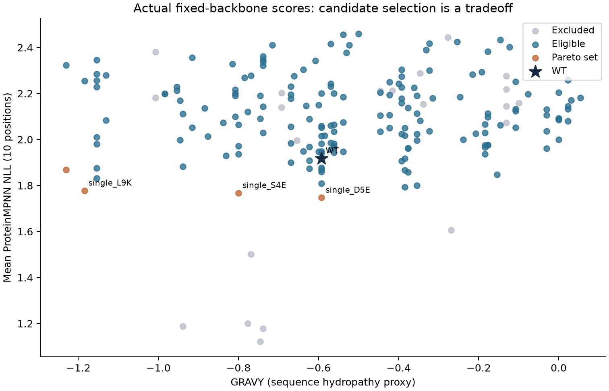

# 序列优化实战：建立候选库、统一评分与提名

> 本文对应网站教案的 Debian 版本。仓库练习请先读同目录 [README](README.md)：其中命令使用本仓库目录和可配置工具路径；正文的运行命令已按仓库路径调整；多工具任务统一通过可配置入口执行。


上一课生成了六条新序列。分数最好的一条是 `ETFEELWAKLPQS`，看起来很有吸引力。但如果项目要求只在原生肽附近作少量改动，它一下改变六个位点，就未必是合适的起点。

这正是序列生成和序列优化之间的区别：生成提供可能性，优化需要先说清楚什么算更好、哪些代价可以接受，再作选择。本章沿用 1YCR 的实验骨架，完成一轮真实的局部优化。我们会从母序列出发，建立 197 条候选，最后保留原生对照和三个待验证变体。

## 1. 先写清这一次允许改什么

母序列仍是 `ETFSDLWKLLPEN`。为了保留已知的结构线索，我们固定 MDM2 受体和肽的 F/W/L 三个热点，只允许改变另外十个位置。

这一次还增加三个项目规则：相对母序列最多改两个位置，不引入新的 C，也不在链内第 4–9 位引入新的 P。C 是半胱氨酸，新增巯基可能增加氧化与制备方面的处理问题；P 是脯氨酸，在当前螺旋样区域引入它，需要考虑主链构象的改变。这些规则依据当前肽的骨架与制备考虑制定；换体系时要重新评估。

“必须满足才能继续”的条件叫**硬约束**。它们先决定一个候选有没有资格进入比较。相比之下，我们希望模型分数更低、突变更少、序列疏水性代理更低，但这些愿望可能互相冲突，需要权衡，这些就是**优化目标**。

筛选时先检查硬约束，再比较合格候选的目标值。若研究问题改变，可以制定新规则，并以新的一轮设计记录结果。

## 2. 197 条候选是怎样来的

先从最容易解释的单点突变开始。十个可变位置，每个位置都可以用另外十九种标准氨基酸替换，所以共有：

$$10\times19=190\text{ 条单点变体}$$

再加入一条原生序列 WT，以及上一课实际生成的六条设计，就得到 197 条。WT 是 wild type，在这里表示作为基线的母序列。

你可以用下面的短代码独立枚举单点库。它帮助理解候选空间，不会调用模型；正式评价仍使用配套脚本。

```python
native = 'ETFSDLWKLLPEN'
alphabet = 'ACDEFGHIKLMNPQRSTVWY'
fixed_positions = {3, 7, 10}
variants = {}

for position, original in enumerate(native, start=1):
    if position in fixed_positions:
        continue
    for replacement in alphabet:
        if replacement == original:
            continue
        sequence = native[:position-1] + replacement + native[position:]
        variant_id = f'{original}{position}{replacement}'
        variants[variant_id] = sequence

print('Single mutants:', len(variants))
print('D5E:', variants['D5E'])
```

输出应是 190 条，以及 D5E 的序列 `ETFSELWKLLPEN`。`D5E` 表示输入肽第 5 位从 D 换成 E；在原始 PDB 中它对应 D21E。这个名字同时告诉我们变了什么、变在哪里。

你可能会问：既然最多允许两处突变，为什么这里只枚举单点？因为本轮希望先把每个位置的影响分开看。两点预算为后续组合设计留出空间；本轮结果的适用范围是实际评价的单点库与六条既有样本。

## 3. 用同一把尺子重评所有序列

为了公平比较上一课的六条样本和新候选，我们统一重新评分。解码顺序、随机上下文、计分位置或骨架一旦不同，差异中就可能混入评价协议的影响。

本次为所有 197 条序列使用相同模型、相同实验骨架、相同十个计分位置，并用共同的八组随机解码顺序评价。对每条序列，我们得到八个平均负对数概率，也就是八个 NLL，然后再汇总均值与波动。

八组解码顺序给出模型分数随计算顺序的变化。标准差用于描述这种计算波动；实验亲和力的误差则由结合测定的重复与拟合评估。

第二个量是 **GRAVY**，即按氨基酸疏水性尺度计算的序列平均值。本轮把更低 GRAVY 作为一个偏好，希望探索较少疏水的序列。它提供了一个易于解释的序列描述。进一步研究溶解度时，还需考虑残基暴露、浓度、pH、聚集和制备条件。

第三个量是突变数。较少的突变便于追踪变化原因，功能变化随后通过相应测定评价。三个量放在一起，才构成这次明确定义的优化问题。

共同随机顺序的作用，可以用一次配对比较理解。某个解码顺序下 WT 和 D5E 都偏高，可能是顺序使预测更困难；在同一个顺序内作差，可以减少这种共同变化对候选比较的影响。八组配对差的均值回答“在本协议下，替换相对 WT 改善多少”，却没有包含实验误差或模型系统偏差。

NLL 也有明确分母：这里只平均十个可变位置。若把固定受体或三个热点也计入，平均值会被大量不变项稀释，甚至改变读者对改善幅度的理解。每次报告分数，都应把骨架、掩码和平均范围一起交代。

## 4. 输入与 Debian 环境

使用已有 `.venv-analysis`，输入来自 Debian GPU 的 ProteinMPNN 结果：

实验骨架来自 `data/peptide/1YCR_original.pdb`；解析后的 `examples/proteinmpnn/parsed.jsonl` 提供两条链的坐标与身份。待合并的六条设计从同目录的 `candidate_summary.csv` 读取，统一评分采用 `data/aidd/ProteinMPNN/vanilla_model_weights/v_48_020.pt`。这四份输入把结构条件、候选来源和评价模型固定下来。


候选库由 WT、十个可变位置的 190 条单点变体和 Debian 生成的六条设计组成。固定热点 B3/B7/B10，接收链为 A，十个可变位置共同参与平均 NLL。

## 5. 从候选库到模型评分，程序依次做什么

第 2 节已经用短代码枚举 190 条单点。完整程序先合并 WT、单点与六条模型样本，再计算序列性质和硬约束，随后统一评分。

其中的两个计算环节值得单独理解。

**先算性质与规则。**Biopython 根据序列计算 GRAVY、自由末端条件下的估计净电荷和分子量。突变数则通过逐位比较母序列获得。下面对两个真实候选作一次小计算：

```bash
python - <<'PY'
from Bio.SeqUtils.ProtParam import ProteinAnalysis

native = 'ETFSDLWKLLPEN'
for name, sequence in [('WT', native), ('D5E', 'ETFSELWKLLPEN'),
                       ('L9K', 'ETFSDLWKKLPEN')]:
    properties = ProteinAnalysis(sequence)
    changed = [i + 1 for i, (a, b) in enumerate(zip(native, sequence)) if a != b]
    print(name, 'changed positions:', changed,
          'GRAVY:', round(properties.gravy(), 4),
          'charge at pH 7:', round(properties.charge_at_pH(7.0), 3))
PY
```

D5E 保留酸性残基的大类性质，本例 GRAVY 与 WT 相同；L9K 把疏水 L 换成带电 K，GRAVY 更低。这里的性质按天然氨基酸和自由末端定义计算；若准备乙酰化、酰胺化或环化分子，需要相应修改化学描述与性质模型。

**再进行统一模型评价。**每条候选与同一骨架组合，程序保留 A 链和三个热点；所有候选共用八组解码顺序。每一组都在相同十个可变位置取平均，再统计均值、SD 和相对 WT 的差值。

可以把一条序列的八个分数写成 `L1…L8`。平均值描述这份协议下的模型偏好，SD 描述顺序敏感性；`delta_nll_vs_wt` 则按同一组顺序与 WT 配对作差。这样，比较时的结构、计分分母和随机上下文都有明确记录。

## 6. 实际运行与验收

在教材根目录、序列环境中执行：

```bash
python scripts/optimize_sequence.py \
  --output runs/06_my_optimization \
  --device cuda --repeats 8 --batch-size 16
```

`--repeats 8` 指八组解码顺序，`--batch-size 16` 指一次处理十六条候选。本轮显式使用 CUDA 和 4 个 CPU 辅助线程。日志会报告已处理的候选区间，输出目录使用新名称。

过程可以沿着下面几份文件检查：

评分前先查看 `library.fasta`，确认 197 条候选及其唯一性；运行后用 `score_audit.npz` 找回逐位 NLL、序列、掩码和随机顺序，复算分数。`candidates.csv` 汇总全部规则、性质和选择标记，`shortlist.csv` 给出 WT 与三个变体，`tradeoffs.png` 将 NLL、GRAVY 和提名连起来。最后用 `run_summary.json` 核对完成状态、参数、输入指纹和各级计数。


模型运行结束后执行验收：

```bash
python scripts/verify_sequence_optimization.py \
  --run runs/06_my_optimization
```

它检查库的完整性、固定受体与热点、十位掩码、逐位分数重算、官方评分函数的一致性、硬约束及 Pareto 方向，并以较小批次重算两条序列，检查批次组织是否改变结果。通过后写出 `verification.json`。

再用自己的结果目录核对筛选过程：

```bash
python - <<'PY'
import csv
import json
from pathlib import Path

run = Path('runs/06_my_optimization')
summary = json.loads((run / 'run_summary.json').read_text())
rows = list(csv.DictReader((run / 'candidates.csv').open()))
assert summary['completed']
print('All candidates:', len(rows))
print('Eligible:', sum(row['hard_pass'] == 'True' for row in rows))
print('Pareto:', sum(row['pareto'] == 'True' for row in rows))
for row in csv.DictReader((run / 'shortlist.csv').open()):
    print(row['candidate_id'], row['sequence'], row['mpnn_nll_mean'])
PY
```

接下来把这个输出与第 7 节逐项比较。发生差异时，先核对输入指纹、模型版本、解码顺序和筛选规则，再分析数值差异。

### 6.1 Debian 候选库实测记录

2026-10-24 使用 Debian GPU 生成的六条序列重建候选库并评分，得到 197 条候选、176 条合格、5 条 Pareto，以及 WT/D5E/S4E/L9K 四条提名。八组共同解码顺序、固定链和批大小一致性检查通过。[候选表](../../examples/debian13_20261023/sequence_debian_only/candidates.csv)、[提名](../../examples/debian13_20261023/sequence_debian_only/shortlist.csv)、[验收](../../examples/debian13_20261023/sequence_debian_only/verification.json)。

所有六条生成样本都超出本次最多两个突变的预算，因此提名来自 WT 与单点库。生成与筛选是不同任务：生成样本可展示模型倾向，筛选规则决定本轮进入验证的候选。

## 7. 先解释为什么排除，再解释为什么保留

本次 197 条中，176 条符合硬规则，21 条被排除。单点库里十条引入新 C，五条在指定区域引入新 P；六条 Debian 模型样本都超过了两处突变的预算。某条可能同时触发多条规则，统计排除数量时，按候选去重；各原因的出现次数另行统计。

最低模型均值恰好来自上一课的 `ETFEELWAKLPQS`：统一重评分后的 NLL 约 1.1221。然而它有六处突变，超出本轮预算。因此它退出本轮提名，留作后续允许较大改动时的比较对象。

再看通过规则的候选。最终 Pareto 集合共有五条，可以按它们各自的取舍依次理解：

WT 的 NLL 均值为 1.9177，GRAVY 为 −0.5923，保留为基线。D5E 只改第 5 位，NLL 降至 1.7470，GRAVY 仍为 −0.5923；S4E 只改第 4 位，NLL 为 1.7673，GRAVY 为 −0.8000。二者代表对模型相容性与平均疏水性的不同取舍，均进入提名。

第 9 位还有两种方案：L9K 的 NLL 为 1.7776、GRAVY 为 −1.1846；L9R 的 NLL 为 1.8691、GRAVY 为 −1.2308。L9R 的疏水性代理更低，L9K 的模型分数更低。本轮保留 L9K，并将另一个名额用于其他位置的假设，最终提名 WT、D5E、S4E、L9K。


这些分数来自本次统一协议，因此 WT 的 1.9177 与上一课生成时 WT 的 1.9195 不必一致。比较突变效果时，使用同一协议下的 WT 作为基线。

## 8. 用两条真实候选理解 Pareto

先比较 D5E 和 S4E。两者都只改一位，D5E 的 NLL 更低，但 S4E 的 GRAVY 更低。根据当前三个目标，谁也没有在每一项上胜过另一条。两条序列分别保留了不同目标上的优势。

如果候选 A 在所有目标上都不比 B 差，而且至少一项更好，我们说 A **支配** B。没有被其他合格候选支配的集合，就是 Pareto 集合。它把不同的权衡保留下来，随后根据项目重点和验证资源作进一步选择。



读这张图时，先找 WT 星号，再看橙色点。向更低 NLL 移动，表示模型更认可；向更低 GRAVY 移动，表示序列疏水性代理降低。图只画了两个目标，突变数量仍参与实际 Pareto 计算，因此仅凭平面上的位置不一定能还原全部筛选规则。

最后从五条中提名四条，保留 WT 对照，以及 D5E、S4E、L9K 三种不同位置的假设。L9R 与 L9K 只差一个位置上的氨基酸选择；本轮要求新增提名之间至少差两个残基，所以不同时保留它们。若研究问题就是比较第 9 位的 K 与 R，这条多样性规则可以在新一轮中换成有针对性的配对设计。

WT 为什么也能留在 Pareto 集合？因为突变数本身是一个目标。所有变体至少改变一位，WT 的突变负担为零；即使某条变体在模型分数和 GRAVY 上更好，也没有在“改动更少”这一项上胜过 WT。因此，Pareto 表示当前目标间没有被全面压过，并不等于已经找到了实验上的最佳序列。

最终四条提名还受到验证预算影响。若预算扩大，可以加入 L9R 专门比较第 9 位的 K/R；若研究问题转向组合突变，则要建立并统一评价新的组合库。两个单点各自有益，并不能保证合并后更好，因为它们可能竞争同一接触、共同改变构象或抵消电荷效应，这类非加和作用称为上位性。

## 9. 把候选名单变成可检验的假设

D5E 保留了酸性侧链的大类特征，适合提出“这个局部替换能否保持结构并改变结合表现”的假设。S4E 增加了一个酸性残基，可能影响电荷和局部环境。L9K 将疏水残基换成带电残基，GRAVY 下降更多，但也可能损失重要疏水接触。

这些候选分别针对保守酸性替换、局部电荷与疏水性提出假设。下一步先复核新序列的结构与界面，再通过制备、结合和功能实验比较各自的收益与代价。

把 D5E 与 S4E 组合时，两个位置可能通过构象、侧链或溶剂环境相互影响，使组合收益偏离两个单点收益之和。这种非加和现象叫上位性。要判断组合，必须把 WT、两个单点和组合放在一致条件下比较。

## 10. 换成 VHH 或 CAR 识别头，哪些思路可以带走

可以带走的是这套步骤：确认母序列和编号，定义允许改变的位置，保留必要结构条件，统一评价，再结合不同目标提名。固定位置和氨基酸限制则依据新体系的编号、结构与制备目标重新制定。

VHH 需要按其编号体系识别 CDR、框架和二硫键相关位置。CAR 的识别头还要放回完整构建中评价：同时评价可溶状态的结合、膜上表达、无抗原背景和杀伤表现。后面的 CAR-T 数据会让这种权衡变得具体。

本章优化的是氨基酸序列。DNA 的同义密码子优化保持蛋白序列不变，主要服务于编码与表达层面的设计。

## 操作中遇到的问题

候选总数变化时，先核对母序列、十个可变位置与六条固定模型样本；低分候选被排除时，查看它自己的 `exclusion_reasons` 和突变预算。重算分数不符则检查权重、十位掩码、共同随机顺序及逐位 NLL，避免把计分范围变化误认为候选性质变化。

引入另一批模型样本，就形成了新的候选库版本，应更新输入、计数和验收条件；输出目录已存在时使用新名称，保留各轮规则与结果，才能解释后续选择为何改变。


## 读完后，试着自己解释

试着不用看表讲清 **197→176→5→4**：建立候选库，排除违反硬约束者，保留多目标权衡，最后按对照与多样性选择提名。四条由一条 WT 对照和三条新变体组成。

再回答：“为什么没选 NLL 最低的序列？”答案应同时提到六处突变和本轮最多两处的预算。用这个具体的排除理由解释硬约束怎样参与决策。

完整输出见 [candidates.csv](../../examples/debian13_20261023/sequence_debian_only/candidates.csv) 与 [shortlist.csv](../../examples/debian13_20261023/sequence_debian_only/shortlist.csv)。八组评分、掩码及规则保存在脚本与 score_audit.npz 中。本章已完成计算与审计，尚无新结构预测或实验验证。下一步读[分子动力学](../03_gromacs/tutorial.md)，理解模拟能为结构判断增加什么证据。
