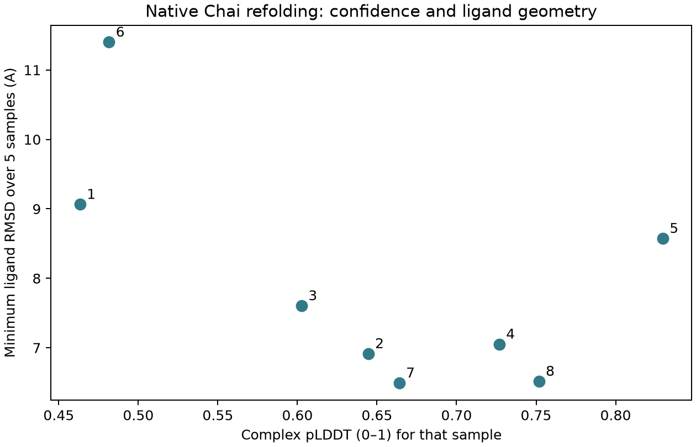

# RFdiffusion2：围绕一组活性位点原子生成蛋白支架

> 本文对应网站教案的 Debian 版本。仓库练习请先读同目录 [README](README.md)：其中命令使用本仓库目录和可配置工具路径；正文的运行命令已按仓库路径调整；多工具任务统一通过可配置入口执行。


前面的课从已有蛋白主链设计序列。现在把任务再往前推一步：只有少数功能原子的位置已经确定，怎样生成能够承载它们的蛋白结构？本课使用 RFdiffusion2 的官方乳酸脱氢酶案例，学习**原子级基序支架化**。

本课的功能约束来自乳酸脱氢酶活性位点、NAD 辅因子和 OXM 配体。它适合解释原子几何、主链生成、序列设计和重新折叠如何衔接。多肽与抗体结合分子设计分别接到 [ProteinMPNN](../02_proteinmpnn/tutorial.md)、[RFantibody](../12_rfantibody/tutorial.md)与 [BoltzGen](../15_boltzgen/tutorial.md)，按任务选择相应工作流。

## 1. 当前版本与学习目标

截至 2026-10-20，官方仓库尚未提供编号 release。本章锁定当日主分支提交 **`d365cbf4db3958814a9f8e4f6f94fa309dfebc2b`**。安装元数据中的 `0.0.0` 是占位版本，复现时以提交号和权重名称为准。入口为 [官方仓库](https://github.com/RosettaCommons/RFdiffusion2)和[官方文档](https://rosettacommons.github.io/RFdiffusion2/)。

完成本课后，应能准备带原子名称的约束、运行一项官方设计任务、辨认生成与序列拟合阶段的产物，并解释“功能原子保留得好”为什么还需要后续折叠和功能验证。

## 2. 输入由哪几部分组成

官方案例 PDB 是 `rf_diffusion/benchmark/input/mcsa_41/M0584_1ldm.pdb`。教材保存了[同一份输入](../../workflows/modern_tools/rfdiffusion2/M0584_1ldm.pdb)与[官方任务配置](../../workflows/modern_tools/rfdiffusion2/open_source_demo.json)，下载 URL 与 SHA256 记录在[输入清单](../../workflows/modern_tools/input_manifest.json)。

这里有三类信息：

参考 PDB 提供活性位点和配体坐标，程序从中提取指定原子；催化基序进一步指定 A106、A166、A169、A193 的部分侧链原子，构成需要保留的几何条件。设计配置再规定配体、主链连接方式、guidepost 和部分固定原子，决定哪些信息保持、哪些结构由模型生成。三者共同定义任务。


**基序，motif**，在这项任务中指具有功能意义的一组残基或原子。**支架，scaffold**，是支持它们的蛋白整体结构。RFdiffusion2 能接收侧链局部原子几何，让生成主链围绕这些条件组织起来。

生成模型从带噪坐标出发，在条件约束下逐步得到结构。RFdiffusion2 使用的 flow matching 可以理解为学习坐标从噪声分布向蛋白结构分布移动的方向；实际采样沿着模型给出的方向分步更新。功能原子提供几何条件，其余结构在这个条件下生成。采样轨迹、中间理想化和最终复核分别保留，便于判断几何是在何时发生变化。

官方配置使用下面十个基序原子：

十个基序原子分别来自 A106 的 NE、CD、CZ，A166 的 OD1、CG，A169 的 NH2、CZ，以及 A193 的 NE2、CD2、CE1。它们是明确的原子身份，不是仅凭残基编号就能替代的一组点。


PDB 原子名要逐个匹配。例如同一残基中的 `NE` 和 `NE2` 表示不同名称，填错后就无法从参考文件定位。配体列表 `NAD,OXM` 同样使用 PDB 中的残基名称。

可以把功能原子看成必须被支撑在空间中的几个连接点。已知这些点的位置，并没有唯一确定周围主链怎样连接、整个蛋白采用什么拓扑，也没有给出能够稳定这种结构的序列。生成模型先寻找能承载条件的几何，序列模型再为几何寻找氨基酸，重新折叠则检验所得序列是否支持这种安排。

这里“100 步”是生成采样的数值步数，与 GROMACS 的 100 个时间步含义不同。生成过程沿模型学习到的方向组织结构，不是记录蛋白在水里经历的真实物理时间；增加生成步数也不能直接换算成模拟时长。

## 3. 在普通电脑上先检查输入

这一步用标准 Python 即可，验证原子、配体和热点是否确实存在：

```bash
cd .
python3 scripts/check_modern_inputs.py \
  --output runs/modern_tools/my_input_checks
```

本地[检查记录](../../examples/debian13_20261023/input_checks/input_checks.json)确认四个基序残基的十个原子均存在，NAD 有 44 个不同原子名，OXM 有 6 个，部分固定的配体原子也全部存在。该记录同时检查了后续 RFantibody 输入，便于在申请 GPU 资源前完成文件验收。

读 PDB 的核心检查可以自己写：

```python
from pathlib import Path

path = Path('workflows/modern_tools/rfdiffusion2/M0584_1ldm.pdb')
available = set()
for line in path.read_text().splitlines():
    if line.startswith('ATOM  '):
        available.add((line[21], int(line[22:26]), line[12:16].strip()))
for atom in ['NE', 'CD', 'CZ']:
    assert ('A', 106, atom) in available
```

切换到自己的功能位点时，先制作“链—残基号—原子名”表，再用同样的检查核对。这样可以在模型运行前发现编号和结构文件不一致的问题。

## 4. Debian 已有环境与资源

RFdiffusion2 源码为 `/opt/bioinfra/repos/RFdiffusion2`，提交 `d365cbf4db3958814a9f8e4f6f94fa309dfebc2b`，主模型与权重使用现有环境。LigandMPNN 与 Chai 的专用环境已获准创建，分别复用 RFdiffusion2 与 RFantibody 的基础依赖。

本机没有 Apptainer，使用[原生适配器](../../scripts/run_rfd_native_pipeline.py)调用同一官方科学阶段。它替换容器启动命令，保留模型代码；旧 OpenFold 的 NumPy 别名映射为同义 builtin。运行工作目录为项目内 ASCII 路径，避免 Hydra 解析中文路径失败。

## 5. 生成一个主链，再完成序列和结构复核

在教材目录运行已经核验的入口：

```bash
# 先在 config/tools.json 配置本章所用环境与模型资源
python practice.py run 11 --output runs/11_new --execute
```

`repaired_gpu` 会恢复已完成的 RFantibody 与 RFdiffusion2 生成任务；本轮 RFdiffusion2 采用官方 demo、100 去噪步、一个主链。`rfd_full` 从该主链进入 LigandMPNN、Chai 与指标汇总。

所有实际命令与开始时间保存在[生成记录](../../examples/debian13_20261023/rfdiffusion2_native.json)和[下游记录](../../examples/debian13_20261023/rfdiffusion2_downstream_native.json)。已有成功记录会跳过，不会隐式重新采样。做新的独立实验时，需要同时指定新的工作目录和执行记录，不能只删除一个完成标志。

## 6. 阶段产物与资源设置

本轮得到 1 个主链、8 条 LigandMPNN 序列，每条 5 个 Chai 预测，共 40 个结构。`compiled_metrics.csv` 有 8 行、681 列，包含指标与配置字段。

Chai 采用官方 `score.chai1.omit_esm_embeddings=True` 选项，关闭可选 3B ESM 嵌入。它减少资源需求，也改变了复核设置，报告时必须保留。不能把结果写成加载完整可选嵌入的运行。

[完整输出](../../examples/debian13_20261023/rfdiffusion2_outputs)、[八候选摘要](../../examples/debian13_20261023/rfdiffusion2_candidate_summary.csv)均可访问。先核对 PDB/TRB、序列数、结构数和汇总行数，再解释置信度。

1 个主链对应 8 条序列，每条序列再预测 5 次，形成 40 个复核结构。这种分支设计便于判断同一几何是否能找到不同序列支持，但 40 份结构共享同一个生成主链，不能视为 40 个独立支架设计。解释设计空间覆盖时，应同时交代主链数、序列数和每序列样本数。

`compiled_metrics.csv` 的 681 列也包含配置与多种阶段指标，列数多不表示得到了同样多的独立验证。先读字段定义与来源，再选与当前问题直接相关的几何和置信度指标，可以避免从大量字段里只挑对设计最有利的数值。

## 7. 基序约束满足后，配体几何是否继续保持

本轮生成的 `motif_rmsd_to_input` 约 3.7×10⁻⁸ Å，理想化基序星座 RMSD 约 0.053 Å。这说明生成阶段保留了指定几何，不能据此认定完整设计成功。

复核后的 `pocket_aligned_total_ligand_rmsd_min` 对每条序列取五样本中最小值，仍为 6.49–11.40 Å。即使选取最有利样本，口袋对齐后的配体几何仍未良好恢复。此处必须明确对齐对象、比较原子及五样本选择方式。



脚本从实际表头提取指标，而不假定其他版本的字段名。复算入口为 `scripts/analyze_debian_rfd.py`。下一轮可检查理想化、侧链装填和复核各阶段的位移来源，再设计控制变量实验；本轮没有酶活性实验。

生成阶段的基序 RMSD 几乎为零，首先说明条件被执行得很准确。因为这些原子本来就是输入约束，满足它们属于任务的必要检查，不能当作独立发现了活性构象。真正进一步的问题是：理想化后还保持吗？序列重新预测后还保持吗？配体在口袋中的相对位置是否一致？

`pocket_aligned_total_ligand_rmsd_min` 先按口袋对齐，再比较配体原子的位置。对每条序列取五次预测中的最小值，是一种有利于候选的 best-of-five 选择；当前即使这样选择仍有 6.49–11.40 Å 偏差，提示需要检查后续几何保持。若不同任务使用不同样本数，最小值也不能直接公平比较，因为更多尝试更容易得到偶然较低值。

催化能力还要求底物、辅因子、关键侧链、质子化状态及反应路径之间配合。几何复核只触及其中部分条件，本轮没有酶活性数据。因此，更准确的结果描述是完成了条件生成和下游复核，并定位到配体几何保持不足。

## 8. 排错与面试重点

若使用容器而看不到 GPU，应从宿主机驱动和 Apptainer `--nv` 检查；本轮原生路线则查看具体环境与设备记录。输入路径报错时注意基准路径相对 `rf_diffusion/benchmark/input/` 解析。基序缺失要逐一核对链、PDB 编号、原子名与缺失侧链。

新结构编号不同于原位点时，通过 unindexed 映射和 TRB 重建对应；生成完成却没有序列或复核产物时，检查 `stop_step`，默认 demo 可能停在 sweep。若基序在生成时保持、复核后移位，则逐阶段比较理想化、LigandMPNN 和 Chai，而不是只重跑最初生成。


本课的逻辑起点是功能原子的空间几何，产物依次是支架、序列和复核结构。unindexed 的用途是把已知空间路标与新序列编号分开：功能原子的位置可以先确定，它们在生成主链中的位置再由模型安排，最后依靠映射重建对应。

把这一思路迁移到其他任务时，需要保留“条件生成后重新检验”的方法，同时重新选择适合分子对象的工作流。CAR 识别头更直接对应抗体或 VHH 设计；原子级基序支架案例本身没有提供 CAR 功能证据。

练习交付：对照运行 `active_site_indexed_atomic` 与本课任务，各生成少量结构，比较基序位置限制和输出映射；随后画出“功能几何→主链→序列→结构复核→实验活性”的项目流程。
