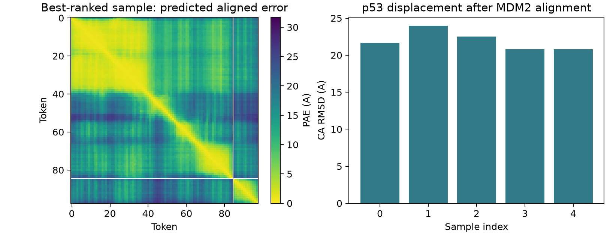

# AlphaFold 3：Debian GPU 复合物预测与参考比较

> 本文对应网站教案的 Debian 版本。仓库练习请先读同目录 [README](README.md)：其中命令使用本仓库目录和可配置工具路径；正文的运行命令已按仓库路径调整；多工具任务统一通过可配置入口执行。


本章只提供人源 MDM2 的 85 aa 和 p53 的 13 aa 序列，使用显式空 MSA、空模板完成五样本预测，再与 1YCR 比较。它与固定主链上的序列设计和侧链精修使用不同的信息，结果也应分别解释。

## 1. 实际版本和运行条件

使用现有 `/opt/micromamba/envs/alphafold3`，Python 3.12、JAX 0.10.2，源码提交 **3033a1ce47a9d107be7db9e644208b63e2d84a92**，包版本 **3.0.5.dev59+g3033a1ce4**。硬件为 RTX 3060 12GB，模型参数位于 `/opt/bioinfra/af3/params`。精确包列表见[环境清单](../../examples/debian13_20261023/environment_inventory.json)。

现有安装缺少构建后的 CCD 字典。本轮复制安装包到项目运行目录，调用官方 build_data，从现有 components.cif 生成字典，再通过 PYTHONPATH 使用该副本。CCD 描述化学组分的原子、键和身份；即使只预测蛋白，也需要它。

## 2. 输入与信息边界

输入为 [human_mdm2_p53_no_msa.json](../../workflows/modern_tools/alphafold3/human_mdm2_p53_no_msa.json)，每条 protein 记录包含 `id`、`sequence`、`unpairedMsa`、`pairedMsa`、`templates`。

A 链采用 1YCR 中有坐标的 85 残基 MDM2，B 链为 13 残基 `ETFSDLWKLLPEN`。`modelSeeds` 设置为 20261020，两类 MSA 均为空字符串，模板为 `[]`。这几项共同定义本轮预测实际获得的信息。

MSA 汇集同源序列的进化变化。空字符串明确选择单序列模式，跳过搜索并不意味着模型已经获得进化信息。原始 PDB 用于确定输入序列和事后评价，预测时没有提供参考坐标模板。

与第二章的关键差别在于，ProteinMPNN 已经拿到复合物主链，本章则要求模型从序列等信息推断结构。前者回答“什么序列适合这套几何”，后者回答“这些序列可能采取什么几何”。两种方法的输入难度与已知条件不同，不能只按最终结构好不好看来判定方法能力。

不提供模板也不等于证明模型从未接触过相关体系。模型参数来自预训练，本章没有做训练集排除或新颖性审计。因此，这一练习评价的是指定构建体与输入设置下的参考恢复，不能作为完全未知靶标上的泛化基准。

## 3. GPU 运行

在教材目录使用已经核验的入口：

```bash
# 先在 config/tools.json 配置本章所用环境与模型资源
python practice.py run 13 --output runs/13_new --execute
```

实际命令见[执行记录](../../examples/debian13_20261023/alphafold3_gpu_repaired.json)：GPU JAX、`run_data_pipeline=false`、XLA attention、bucket=128、五个 diffusion samples，recycle 使用当前源码默认设置。复现时以保存的命令和实际配置为准，不用其他版本的默认值代替。

Bucket 将 98 个 token 补齐到 128；XLA attention 是本轮在现有设备上采用的实现。已完成任务会跳过；独立实验应使用新的输出目录和记录。

五个 diffusion samples 是同一输入下的多个结构尝试；recycle 则是在模型内部反复更新表示，二者不是同一种重复。它们都不表示分子在溶液中经历了多少物理时间。bucket=128 是计算形状的补齐设置，本轮输入仍然是 98 个残基，不会因此变成一条 128 残基蛋白。

## 4. 输出怎么读

先用 `ranking_scores.csv` 读取完整精度排序分数，再对应各样本的 `*_model.cif` 坐标。`*_summary_confidences.json` 提供 pTM、iPTM 等摘要，`*_confidences.json` 保存逐原子 pLDDT、PAE 等细节；输入和配置文件则用于确认序列、种子和运行条件。这样，选中的结构、选择理由与实际输入能够相互对应。


pLDDT 描述局部置信度，pTM 描述整体安排，iPTM 更关注链间界面，PAE 则给出不同区域相对位置的不确定性。没有单一指标能直接证明实验结合。

注意摘要 JSON 的排序数值可能已四舍五入。分析器使用 `ranking_scores.csv` 的完整精度，避免把舍入后看似并列的样本误选为最高排名。

局部形状与跨链安排可以分别理解：一段肽的局部骨架可能被模型判断为可信，但它可以整体放在受体的多个位置。此时局部 pLDDT 与界面 iPTM/跨链 PAE 会回答不同问题。PAE 是模型预计的对齐误差，而不是事后把预测与实验结构叠合得到的误差，阅读热图时尤其要区分链内区块和跨链区块。输出定义见 [AF3 官方说明](https://github.com/google-deepmind/alphafold3/blob/main/docs/output.md)。

这些置信度应结合分子长度、构建体和任务解释。13 残基短肽提供的信息与长结构域不同，本章不以单一通用阈值替代参考比较。先把样本选取规则固定，再报告全部样本的实际偏差，能够避免事后只挑看起来最好的一份。

## 5. 五样本实际结果

先核对两条链的序列，再按 85 个 MDM2 CA 叠合，计算 13 个 p53 CA 相对参考的位置差。

样本 0 的 pTM 为 0.50、iPTM 为 0.14、排序分数为 0.276936，按 MDM2 对齐后的 p53 CA RMSD 为 21.652 Å。样本 1 的对应值为 0.49、0.17、0.300708 和 23.955 Å；样本 2 则为 0.49、0.16、0.289817 和 22.523 Å。

样本 3 的 pTM 为 0.50、iPTM 为 0.17、排序分数为 0.303909，p53 CA RMSD 为 20.801 Å，是按完整精度排序选中的模型。样本 4 的对应值为 0.50、0.16、0.295855 和 20.811 Å。五份结构都没有在本轮设置下恢复接近参考的 p53 相对位置。


样本 3 排名最高，iPTM=0.17，MDM2 CA RMSD=6.897 Å，p53 位移为 20.801 Å。所有样本 iPTM 为 0.14–0.17，p53 位移为 20.80–23.96 Å。当前设置没有可靠恢复参考结合摆放，受体构象本身也有明显差异。



这是完整运行后的负结果。下一轮应先评估构建体与进化信息，再改变采样规模；仅增加样本不能保证解决信息准备的问题。与 Boltz 的差异是本案例、输入和配置下的观察，不是跨模型准确率基准。

低 iPTM 与较大的参考偏差在本例中共同提示链间安排缺乏支持，但这个负结果没有推翻 MDM2/p53 的已知结合。它只表明当前截短序列、空 MSA、空模板及采样设置下没有可靠恢复参考。下一轮如果想研究 MSA 的作用，应固定模型与其他参数，比较有无 MSA 的成对运行；直接拿另一模型的结果作对照，无法将差异单独归因于 MSA。

## 6. 复算与验收

```bash
python scripts/analyze_af3_case.py \
  --run examples/debian13_20261023/alphafold3_gpu_repaired/human_mdm2_p53_workflow \
  --output runs/my_af3_analysis
```

[五样本表](../../examples/debian13_20261023/alphafold3_analysis/sample_comparison.csv)与[分析摘要](../../examples/debian13_20261023/alphafold3_analysis/analysis_summary.json)保存链身份、叠合定义和全部样本，不只展示最好的一份。

验收顺序：确认五份结构齐全；确认链身份和残基数；读取完整精度排名；核对 PAE 的链边界；事后叠合并报告参考偏差。评价参考结构不得混入声称无模板的预测输入。

## 7. 练习与下一步

用自己的话说明 pLDDT 较高为何不等于界面正确，并比较第十四章在相同序列、空 MSA 条件下的结果。若要补完整数据管线，需要另外准备数据库、搜索资源和新的输入记录；本轮没有完成该扩展。

交付练习应包含输入 JSON、实际版本、五样本评分、PAE 图、参考对齐方法及负结果解释。不能把程序完成表述成结合构象预测成功。
